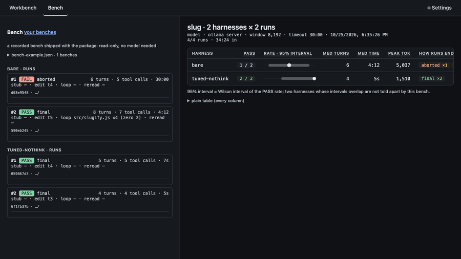

**English** · [Українська](README.uk.md)

# llm-harness-builder

**See what your agent harness really sends to the model — local or cloud — and why it fails.**

[Install](#install) · [Quick start](#quick-start) · [Documentation](#learn-more) · [Українська](README.uk.md)

An agent harness is the code around a model: the system prompt, the tools it may call, and the loop that feeds
results back. This is a small workbench for the model layer of that harness: system prompt, tool description format, native
vs prompted tool calls, schema enforcement, tool-output truncation, context budget. Every run is a
JSONL trace of exactly what went to the model and what came back.

Not a coding agent for daily work. A lab for understanding why your 8B model breaks.

No model needed to look: `npx llm-harness-builder`, then **Start here** → **PASS**.

## Install

Nothing to install for a try — `npx` fetches it (pin a version with `npx llm-harness-builder@0.5.1`):

    npx llm-harness-builder --help

Or install it globally:

    npm install -g llm-harness-builder

It needs Node.js 22.12 or later and a model server: [Ollama](https://ollama.com), llama-server
(`--jinja` for native tool calls), LM Studio, vLLM, or a hosted API key. As a dev dependency, from the
release archive, in a container or from source: [docs/install.md](docs/install.md).

## Quick start

    ollama pull qwen3:8b                                 # once; needs Ollama running
    npx llm-harness-builder demo --model qwen3:8b
    npx llm-harness-builder                              # opens the workbench UI

Against anything that speaks the OpenAI API (llama-server, LM Studio, vLLM):

    npx llm-harness-builder demo \
      --kind openai --base-url http://127.0.0.1:8080/v1 \
      --model unsloth/Qwen3-8B-GGUF:Q4_K_M

`demo` runs the same task once with each of three harnesses, `bare`, `tuned-nothink` and
`tuned-hermes`, on the same model, and prints PASS/FAIL from a check script. On a hosted API
(`--kind openai` with `--api-key-env`, OpenRouter for one) `tuned` takes the place of
`tuned-nothink`, because such an API refuses `backend.think`. `bench` repeats it and reports PASS
rates:

    npx llm-harness-builder bench --n 5 \
      --kind openai --base-url http://127.0.0.1:8080/v1 \
      --model unsloth/Qwen3-8B-GGUF:Q4_K_M

From zero to a first PASS:

1. Install [Ollama](https://ollama.com) and start it.
2. `ollama pull qwen3:8b`
3. `npx llm-harness-builder demo`, or open the UI and follow Start here.

Run `demo` first: it takes a few minutes and shows you the trace and that the backend is alive.
`bench --n 5` on the setup of [Bench results](docs/findings.md#bench-results) took 96 minutes, most
of it `bare`.

No GPU? See [Cloud](docs/configuration.md#cloud): a free OpenRouter account runs the demo.

Try it by hand: the [lab kit](https://github.com/bambooplanedev/llm-harness-builder/tree/main/docs/lab) has three short exercises, one of them with no model.

Why `tuned-nothink` and not `tuned`:

| harness | what differs from `tuned` | PASS | how runs ended | time per run |
|---|---|---|---|---|
| `tuned` | — (thinking on, the model's default) | 0/2 | `parse_failed` ×2: thinking eats the 1024-token cap, empty replies | — |
| `tuned` + `think: false` | thinking off | 0/2 | `max_turns` ×2: the same failing `edit_file` repeated | — |
| `tuned-nothink` | thinking off, `explainEditMiss`, `editMissEscalation: 2` | 5/5 | `final` ×5 | 5–18 s |
| `bare` | one-line prompt, native tool calls, no reply cap, no output limits | 2/4 | across three benches; two runs aborted at 1800 s after endless generation | — |

qwen3:8b on Ollama (RTX 4070 laptop), `slug` task, n = 2–5: this model on this task, small n.
`tuned` fails on a thinking model because its `maxTokens: 1024` covers the thinking too: qwen3 on
Ollama thinks unless told not to, spends the whole cap there and sends back an empty reply.

## How it works

| piece | what it is |
|---|---|
| [harness file](docs/configuration.md#harness-file) | one JSON file: backend, prompts, tools, limits; no paths to your machine |
| [run](docs/cli.md#run) | one harness, one task, one folder, from the [web UI](docs/web-ui.md) or the CLI, each command approved |
| [trace](docs/web-ui.md) | each request as sent and each reply as received, one JSONL file per run in `./runs` |
| [bench](docs/cli.md#bench) | several harnesses on one task many times: PASS rates with 95% Wilson intervals, decided by a check script |
| [diff](docs/web-ui.md) · [replay](docs/cli.md#replay) | which knobs differ between two runs and where their paths split; one recorded request sent again N times |

Backends: Ollama, llama-server, LM Studio, vLLM, any OpenAI-compatible API with a key and the
Anthropic Messages API ([configuration](docs/configuration.md#backends)). Tools can come from
[MCP servers](docs/mcp-and-hooks.md#mcp), a [prompt hook](docs/mcp-and-hooks.md#prompt-hook) puts a
command's output ahead of the task, and the [recording proxy](docs/recording.md) makes another
agent's conversations (opencode, Claude Code) traces too.

A trace is one JSON line per event; here is turn 3 of the **Start here** PASS run, abbreviated:

    {"seq":13,"turn":3,"type":"llm_request","payload":{…}}
    {"seq":14,"turn":3,"type":"llm_response","content":"{\"calls\": [{\"name\": \"read_file\", \"args\": {\"path\": \"src/slugify.js\"}}], \"final\": null}","usage":{"promptTokens":871,"completionTokens":30}}
    {"seq":15,"turn":3,"type":"tool_call","call":{"callId":"c3","name":"read_file","args":{"path":"src/slugify.js"}}}
    {"seq":16,"turn":3,"type":"tool_result","callId":"c3","name":"read_file","output":"export function slugify(s) {\n  return s.toLowerCase()…","truncated":false,"error":false}
    …
    {"seq":28,"turn":5,"type":"done","reason":"final","text":"Fixed slugify.js to strip leading and trailing dashes, and all tests passed.","turns":5,"toolCallCount":5}

and what the request of that turn was made of, as the UI prints it (prompted mode, so the tool
descriptions are part of the system prompt; each share is rounded on its own):

    system + tools 75% · history 15% · tool results 11% · 871 tok

## CLI

    llm-harness-builder --help | --version | help <command>
    llm-harness-builder serve [--port <n>] [--no-open]
    llm-harness-builder run <harness.json> "task" [--workdir <dir>] [--yes] [--json] [--answer-schema <file.json>] [--model <m>] [--base-url <u>] [--kind <k>] [--api-key-env <NAME>]
    llm-harness-builder demo [--json] [--model <m>] [--base-url <u>] [--kind <k>] [--api-key-env <NAME>]
    llm-harness-builder bench [harness.json ...] [--n <n>] [--timeout <s>] [--out <file>] [--task <name>] [--size <N>] [--tasks <repo>] [--only <a,b>] [--yes] [--max-turns <N>] [--wide] [--models <a,b>] [--model <m>] [--base-url <u>] [--kind <k>] [--api-key-env <NAME>]
    llm-harness-builder evolve <harness.json> [--tasks <repo>] [--task polyglot] [--mode <m>] [--size <N>] [--rounds <N>] [--proposer <harness.json>] [--max-usd <dollars>] [--timeout <s>] [--yes] [--report] [--model <m>] [--base-url <u>] [--kind <k>] [--api-key-env <NAME>]
    llm-harness-builder replay <run-id | trace.jsonl> [--turn <N>] [--n <n>] [--temperature <t>] [--max-tokens <m>] [--base-url <u>] [--kind <k>] [--api-key-env <NAME>] [--json]
    llm-harness-builder analyze <bench.json | run-id | trace.jsonl> ... [--json]
    llm-harness-builder proxy [--upstream <url>] [--port <n>] [--name <label>] [--dialect <abs.mjs>] [--connection <abs.json>]

| command | what it does |
|---|---|
| `serve` | the web UI |
| `run` | one harness, one task, one folder |
| `demo` | the demo task once per shipped harness |
| `bench` | a task `--n` times per harness, with a PASS-rate table and a JSON |
| `evolve` | improves a harness on your own tasks, one edit at a time, keeping only what wins on tasks it never saw |
| `replay` | one recorded request sent again `--n` times |
| `analyze` | what the context budget removed, and what the model did after |
| `proxy` | records another agent's conversations as traces |

Every command's options, the exit codes and the approvals: [docs/cli.md](docs/cli.md).

## What it found

One model and one task each, small n ([how to read](#how-to-read-the-results)):

1. **Thinking ate the reply cap.** `tuned` 0/2 (`parse_failed`); thinking off alone 0/2
   (`max_turns`, the same failing edit); `tuned-nothink` — thinking off plus `explainEditMiss` and
   `editMissEscalation: 2` — 5/5. qwen3:8b on Ollama, `slug`. ([table](#quick-start))
2. **A rule in the prompt beat the same rule in code.** "Read a file before you change it" as a
   sentence: 5/5; as a guard in code without the sentence: 0/5, the next miss repeated to
   `max_turns`. ([Read before edit](docs/findings.md#read-before-edit))
3. **Explaining an edit miss shortened the loop; the model never used the explanation.** Eleven
   identical failing calls in a row became seven; shown 16 times, used 0.
   ([Explaining an edit miss](docs/findings.md#explaining-an-edit-miss))
4. **A context budget held the window and cost passes.** `pool2` on a 5120 window: no budget died
   at 5344 tokens; `budgetTokens` 2670 stayed at or under 3364, PASS 1/3, and 0/3 with the 0.75·B
   low-water mark that ships. Qwen3-8B on llama-server.
   ([The measurement, on `pool2`](docs/findings.md#the-measurement-on-pool2))
5. **A repeat detector stops a loop; it does not fix it.** `loop.maxRepeats` ended a loop at turn
   12 in 57 s where `guard-only` ran 15 turns; on a replayed flip-flop all ten replies, with the old
   notes or the new, were the same undo. ([Noticing a repeated call](docs/findings.md#noticing-a-repeated-call))

### How to read the results

Every number in this README and in [the findings](docs/findings.md), and every "did not help", comes
from one model — Qwen3-8B Q4_K_M on llama-server — and three small tasks, two of which are the same
ten units in another order; five runs or fewer per arm, often near-clones at temperature 0.2. The
one exception is its own section, [A second model](docs/findings.md#a-second-model-2026-10-09),
three runs per arm of one other model on two of those tasks, plus the one-run Anthropic checks in
[Anthropic](docs/configuration.md#anthropic). A result here says what that model did on that task with that harness. It does
not say what a knob does: a knob that moved nothing here may move another model, or this one on
another task, and a knob that helped here may not help yours. That is what `bench` and the traces
are for. The knobs that showed no effect are still in the tool, off by default, for that reason; the
one change that was dropped (the labelled stub) was dropped for what it cost, and its paragraph says
on what evidence. At five runs an interval is wide: `bench` prints the 95% one next to every PASS
count now, and the tables in the findings, printed before it did, carry none.

### Findings

What was measured with this tool, each section with its setup and its traces, in
[docs/findings.md](docs/findings.md). Read [How to read the results](#how-to-read-the-results) first.

- [Read before edit](docs/findings.md#read-before-edit) — `requireReadBeforeEdit` against the
  sentence in the prompt that asks for the same.
- [Bench results](docs/findings.md#bench-results) — `bare`, `tuned` and `tuned-hermes` on the old
  task, one run step by step, and two more that isolate the knobs.
- [Explaining an edit miss](docs/findings.md#explaining-an-edit-miss) — `explainEditMiss`.
- [Noticing a repeated call](docs/findings.md#noticing-a-repeated-call) — `loop.maxRepeats`.
- [The pool task](docs/findings.md#the-pool-task) — `pool` and `pool2`, and what
  `context.budgetTokens` did on them.
- [Three ways out of a loop](docs/findings.md#three-ways-out-of-a-loop) — `repeatTemperature`,
  `freshContext`, `untilBash` and `repeatThinkTokens`.
- [A second model, 2026-10-09](docs/findings.md#a-second-model-2026-10-09) — Bonsai 2 27B on the old
  task and on `pool2`.

## Learn more

- [CLI](docs/cli.md): every command's options, the exit codes and the approvals.
- [Configuration](docs/configuration.md): the harness file, backends, cloud, Anthropic, model families.
- [MCP and the prompt hook](docs/mcp-and-hooks.md): tools from MCP servers, a command before the first request.
- [Recording another agent](docs/recording.md): `proxy` between an agent and its server.
- [Web UI](docs/web-ui.md): Workbench, Bench, the strip of requests, `?film=1`, Start here.
- [Installation](docs/install.md): dev dependency, release archive, container.
- [Findings](docs/findings.md): what was measured, each with its setup and its traces.
- [Honest notes](docs/honest-notes.md): known failure paths, what the redaction misses, what is not a
  sandbox, and what the numbers do not say.
- [The curator tasks](docs/curator.md): `sift`, `triage` and `judge`, and how they were measured.
- [Your own dialects and connections](docs/dialects.md): your own API formats and agent connections for `proxy`.
- [The lab kit](https://github.com/bambooplanedev/llm-harness-builder/tree/main/docs/lab): three short exercises, one of them with no model.
- [Development](docs/development.md): from source, tests, the release.

## Contribute

Issues and pull requests are welcome: see [Development](docs/development.md).

## License

[MIT](LICENSE)
