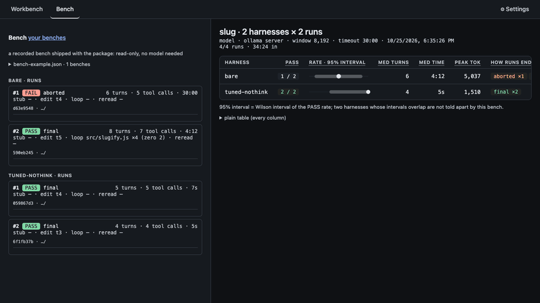

[English](README.md) · **Українська**

# llm-harness-builder

**Подивіться, що ваш агентний харнес насправді надсилає моделі — локальній чи хмарній — і чому він ламається.**

[Встановлення](#встановлення) · [Швидкий старт](#швидкий-старт) · [Документація](#докладніше) · [English](README.md)

Агентний харнес — це код довкола моделі: системний промпт, інструменти, які вона може викликати, і
цикл, що повертає їй результати. Це невеликий верстат для модельного шару такого харнесу: системний
промпт, формат опису інструментів, нативні чи промптові виклики, примус до схеми, обрізання виводу
інструментів, бюджет контексту. Кожен прогін — JSONL-трейс того, що саме пішло до моделі і що
повернулося.

Це не агент для щоденного кодування. Це лабораторія, щоб зрозуміти, чому ваша 8B-модель ламається.

Щоб подивитися, модель не потрібна: `npx llm-harness-builder`, потім **Почніть звідси** → **PASS**.

## Встановлення

Щоб спробувати, нічого встановлювати не треба — `npx` завантажить сам (версію можна закріпити:
`npx llm-harness-builder@0.5.1`):

    npx llm-harness-builder --help

Або встановіть глобально:

    npm install -g llm-harness-builder

Потрібні Node.js 22.12 або новіший і сервер моделі: [Ollama](https://ollama.com), llama-server
(`--jinja` для нативних викликів інструментів), LM Studio, vLLM або ключ хмарного API. Як
dev-залежність, з архіву релізу, у контейнері чи з вихідного коду: [docs/install.uk.md](docs/install.uk.md).

## Швидкий старт

    ollama pull qwen3:8b                                 # once; needs Ollama running
    npx llm-harness-builder demo --model qwen3:8b
    npx llm-harness-builder                              # opens the workbench UI

Із будь-чим, що говорить мовою OpenAI API (llama-server, LM Studio, vLLM):

    npx llm-harness-builder demo \
      --kind openai --base-url http://127.0.0.1:8080/v1 \
      --model unsloth/Qwen3-8B-GGUF:Q4_K_M

`demo` запускає ту саму задачу по разу з кожним із трьох харнесів — `bare`, `tuned-nothink` і
`tuned-hermes` — на тій самій моделі й друкує PASS/FAIL за скриптом перевірки. На хмарному API
(`--kind openai` з `--api-key-env`, наприклад OpenRouter) замість `tuned-nothink` іде `tuned`, бо
такий API відхиляє `backend.think`. `bench` повторює це й видає частки PASS:

    npx llm-harness-builder bench --n 5 \
      --kind openai --base-url http://127.0.0.1:8080/v1 \
      --model unsloth/Qwen3-8B-GGUF:Q4_K_M

Від нуля до першого PASS:

1. Встановіть [Ollama](https://ollama.com) і запустіть її.
2. `ollama pull qwen3:8b`
3. `npx llm-harness-builder demo` — або відкрийте інтерфейс і пройдіть «Почніть звідси».

Почніть із `demo`: це кілька хвилин, і ви побачите трейс та переконаєтеся, що бекенд живий.
`bench --n 5` на установці з [Bench results](docs/findings.md#bench-results) (англійською) тривав 96 хвилин,
здебільшого на `bare`.

Немає GPU? Див. [Хмара](docs/configuration.uk.md#хмара): безкоштовного акаунта OpenRouter досить для демо.

Спробуйте руками: у [наборі вправ](https://github.com/bambooplanedev/llm-harness-builder/tree/main/docs/lab) три короткі вправи, одна з них — без моделі.

Чому `tuned-nothink`, а не `tuned`:

| харнес | чим відрізняється від `tuned` | PASS | чим закінчилися прогони | час на прогін |
|---|---|---|---|---|
| `tuned` | — (thinking увімкнено, як за замовчуванням у моделі) | 0/2 | `parse_failed` ×2: thinking з'їдає ліміт у 1024 токени, відповіді порожні | — |
| `tuned` + `think: false` | thinking вимкнено | 0/2 | `max_turns` ×2: той самий невдалий `edit_file` знову і знову | — |
| `tuned-nothink` | thinking вимкнено, `explainEditMiss`, `editMissEscalation: 2` | 5/5 | `final` ×5 | 5–18 с |
| `bare` | однорядковий промпт, нативні виклики, без ліміту відповіді й обмежень виводу | 2/4 | за три бенчі; два прогони обірвано на 1800 с після нескінченної генерації | — |

qwen3:8b на Ollama (ноутбук з RTX 4070), задача `slug`, n = 2–5: ця модель на цій задачі, мала
вибірка. `tuned` падає на моделі, що думає, бо його `maxTokens: 1024` покриває й thinking: qwen3 на
Ollama думає, якщо їй не сказати інакше, витрачає на це весь ліміт і повертає порожню відповідь.

## Як це працює

| частина | що це |
|---|---|
| [файл харнесу](docs/configuration.uk.md#файл-харнесу) | один JSON-файл: бекенд, промпти, інструменти, обмеження; без шляхів до вашої машини |
| [прогін](docs/cli.uk.md#run) | один харнес, одна задача, одна тека, з [веб-інтерфейсу](docs/web-ui.uk.md) чи з CLI, кожна команда — зі схваленням |
| [трейс](docs/web-ui.uk.md) | кожен запит таким, яким його надіслано, і кожна відповідь такою, якою прийшла, — один JSONL-файл на прогін у `./runs` |
| [бенч](docs/cli.uk.md#bench) | кілька харнесів на одній задачі багато разів: частки PASS з 95% інтервалами Вілсона, вердикт дає скрипт перевірки |
| [diff](docs/web-ui.uk.md) · [replay](docs/cli.uk.md#replay) | які ручки відрізняються між двома прогонами і де розходяться їхні шляхи; один записаний запит, надісланий ще N разів |

Бекенди: Ollama, llama-server, LM Studio, vLLM, будь-який OpenAI-сумісний API з ключем і Anthropic
Messages API ([налаштування](docs/configuration.uk.md#бекенди)). Інструменти можуть іти з
[MCP-серверів](docs/mcp-and-hooks.uk.md#mcp), [хук промпту](docs/mcp-and-hooks.uk.md#хук-промпту)
ставить вивід команди перед завданням, а [записувальний проксі](docs/recording.uk.md) робить трейсами
й розмови іншого агента (opencode, Claude Code).

Трейс — це один рядок JSON на подію; ось хід 3 прогону PASS із **Почніть звідси**, скорочено:

    {"seq":13,"turn":3,"type":"llm_request","payload":{…}}
    {"seq":14,"turn":3,"type":"llm_response","content":"{\"calls\": [{\"name\": \"read_file\", \"args\": {\"path\": \"src/slugify.js\"}}], \"final\": null}","usage":{"promptTokens":871,"completionTokens":30}}
    {"seq":15,"turn":3,"type":"tool_call","call":{"callId":"c3","name":"read_file","args":{"path":"src/slugify.js"}}}
    {"seq":16,"turn":3,"type":"tool_result","callId":"c3","name":"read_file","output":"export function slugify(s) {\n  return s.toLowerCase()…","truncated":false,"error":false}
    …
    {"seq":28,"turn":5,"type":"done","reason":"final","text":"Fixed slugify.js to strip leading and trailing dashes, and all tests passed.","turns":5,"toolCallCount":5}

і з чого складався запит цього ходу, як його друкує інтерфейс (промптовий режим, тож описи
інструментів — частина системного промпту; кожну частку округлено окремо):

    system + tools 75% · history 15% · tool results 11% · 871 tok

## CLI

    llm-harness-builder --help | --version | help <command>
    llm-harness-builder serve [--port <n>] [--no-open]
    llm-harness-builder run <harness.json> "task" [--workdir <dir>] [--yes] [--json] [--answer-schema <file.json>] [--model <m>] [--base-url <u>] [--kind <k>] [--api-key-env <NAME>]
    llm-harness-builder demo [--json] [--model <m>] [--base-url <u>] [--kind <k>] [--api-key-env <NAME>]
    llm-harness-builder bench [harness.json ...] [--n <n>] [--timeout <s>] [--out <file>] [--task <name>] [--size <N>] [--tasks <repo>] [--only <a,b>] [--yes] [--max-turns <N>] [--wide] [--models <a,b>] [--model <m>] [--base-url <u>] [--kind <k>] [--api-key-env <NAME>]
    llm-harness-builder evolve <harness.json> [--tasks <repo>] [--task polyglot] [--mode <m>] [--size <N>] [--rounds <N>] [--proposer <harness.json>] [--max-usd <dollars>] [--timeout <s>] [--yes] [--report] [--model <m>] [--base-url <u>] [--kind <k>] [--api-key-env <NAME>]
    llm-harness-builder replay <run-id | trace.jsonl> [--turn <N>] [--n <n>] [--temperature <t>] [--max-tokens <m>] [--base-url <u>] [--kind <k>] [--api-key-env <NAME>] [--json]
    llm-harness-builder analyze <bench.json | run-id | trace.jsonl> ... [--json]
    llm-harness-builder proxy [--upstream <url>] [--port <n>] [--name <label>] [--dialect <abs.mjs>] [--connection <abs.json>]

| команда | що робить |
|---|---|
| `serve` | веб-інтерфейс |
| `run` | один харнес, одна задача, одна тека |
| `demo` | демо-задача по разу на кожен харнес із пакета |
| `bench` | задача `--n` разів на харнес, з таблицею часток PASS і JSON |
| `evolve` | покращує харнес на ваших задачах, по одній правці, лишаючи лише те, що виграє на задачах, яких він не бачив |
| `replay` | один записаний запит, надісланий ще `--n` разів |
| `analyze` | що прибрав бюджет контексту і що модель робила після цього |
| `proxy` | записує розмови іншого агента як трейси |

Опції кожної команди, коди виходу і схвалення: [docs/cli.uk.md](docs/cli.uk.md).

## Що знайдено

Щоразу одна модель і одна задача, мала вибірка ([як читати](#як-читати-результати)):

1. **Thinking з'їв ліміт відповіді.** `tuned` 0/2 (`parse_failed`); саме лише вимкнене thinking —
   0/2 (`max_turns`, той самий невдалий `edit_file`); `tuned-nothink` — вимкнене thinking плюс
   `explainEditMiss` і `editMissEscalation: 2` — 5/5. qwen3:8b на Ollama, `slug`.
   ([таблиця](#швидкий-старт))
2. **Правило в промпті спрацювало краще за те саме правило в коді.** «Прочитай файл, перш ніж
   змінювати» реченням: 5/5; запобіжником у коді без речення: 0/5, наступний промах повторювався
   до `max_turns`. ([Read before edit](docs/findings.md#read-before-edit) (англійською))
3. **Пояснення промаху редагування вкоротило петлю; модель ним так і не скористалася.** Одинадцять
   однакових невдалих викликів поспіль стали сімома; показано 16 разів, використано 0.
   ([Explaining an edit miss](docs/findings.md#explaining-an-edit-miss) (англійською))
4. **Бюджет контексту втримав вікно, але коштував успішних прогонів.** `pool2` на вікні 5120: без
   бюджету прогін помер на 5344 токенах; з `budgetTokens` 2670 тримався не вище 3364, PASS 1/3, а з
   позначкою 0.75·B, що є в пакеті, — 0/3. Qwen3-8B на llama-server.
   ([The measurement, on `pool2`](docs/findings.md#the-measurement-on-pool2) (англійською))
5. **Детектор повтору зупиняє петлю, але не лікує її.** `loop.maxRepeats` обірвав петлю на ході
   12 за 57 с, де `guard-only` пройшов 15 ходів; на відтвореному фліп-флопі всі десять відповідей,
   зі старими примітками чи з новими, були тим самим відкатом.
   ([Noticing a repeated call](docs/findings.md#noticing-a-repeated-call) (англійською))

### Як читати результати

Кожне число в цьому README і в [висновках](docs/findings.md) (англійською), і кожне «не допомогло» походить від
однієї моделі — Qwen3-8B Q4_K_M на llama-server — і трьох маленьких задач, дві з яких — ті самі десять
модулів в іншому порядку; п'ять прогонів чи менше на плече, часто майже клони за температури 0.2.
Єдиний виняток — окремий розділ, [A second model](docs/findings.md#a-second-model-2026-10-09) (англійською): по
три прогони на плече іншої моделі на двох із цих задач, плюс однопрогонні перевірки Anthropic у розділі
[Anthropic](docs/configuration.uk.md#anthropic). Результат тут каже, що зробила ця модель на цій задачі з цим харнесом. Він не
каже, що робить ручка: ручка, яка тут нічого не зрушила, може зрушити іншу модель або цю на іншій
задачі, а ручка, що допомогла тут, може не допомогти вашій. Для цього і є `bench` та трейси. Ручки,
що не показали ефекту, з цієї причини лишаються в інструменті, вимкнені за замовчуванням; єдину
зміну, від якої відмовилися (стаб із підписом), прибрали через її ціну, і її абзац каже, на яких
підставах. На п'яти прогонах інтервал широкий: тепер `bench` друкує 95% інтервал поряд з кожною
кількістю PASS, а таблиці у висновках, надруковані до того, їх не мають.

### Висновки

Що було виміряно цим інструментом, кожен розділ з установкою і трейсами, — у
[docs/findings.md](docs/findings.md) (англійською). Спершу прочитайте [Як читати результати](#як-читати-результати).

- [Read before edit](docs/findings.md#read-before-edit) — `requireReadBeforeEdit` проти речення в
  промпті, що просить того самого.
- [Bench results](docs/findings.md#bench-results) — `bare`, `tuned` і `tuned-hermes` на старій
  задачі, один прогін крок за кроком і ще два, що ізолюють ручки.
- [Explaining an edit miss](docs/findings.md#explaining-an-edit-miss) — `explainEditMiss`.
- [Noticing a repeated call](docs/findings.md#noticing-a-repeated-call) — `loop.maxRepeats`.
- [The pool task](docs/findings.md#the-pool-task) — `pool` і `pool2`, і що на них зробив
  `context.budgetTokens`.
- [Three ways out of a loop](docs/findings.md#three-ways-out-of-a-loop) — `repeatTemperature`,
  `freshContext`, `untilBash` і `repeatThinkTokens`.
- [A second model, 2026-10-09](docs/findings.md#a-second-model-2026-10-09) — Bonsai 2 27B на старій
  задачі й на `pool2`.

## Докладніше

- [CLI](docs/cli.uk.md): опції кожної команди, коди виходу і схвалення.
- [Налаштування](docs/configuration.uk.md): файл харнесу, бекенди, хмара, Anthropic, сімейства моделей.
- [MCP і хук промпту](docs/mcp-and-hooks.uk.md): інструменти з MCP-серверів, команда перед першим запитом.
- [Запис іншого агента](docs/recording.uk.md): `proxy` між агентом і його сервером.
- [Веб-інтерфейс](docs/web-ui.uk.md): Workbench, Bench, смуга запитів, `?film=1`, «Почніть звідси».
- [Встановлення](docs/install.uk.md): dev-залежність, архів релізу, контейнер.
- [Висновки](docs/findings.md) (англійською): що було виміряно, кожен розділ з установкою і трейсами.
- [Чесні примітки](docs/honest-notes.uk.md): відомі шляхи до провалу, чого не ловить маскування, що
  не є пісочницею і чого не кажуть числа.
- [Задачі куратора](docs/curator.uk.md): `sift`, `triage` і `judge`, і як їх міряли.
- [Власні діалекти й підключення](docs/dialects.uk.md): власні формати API і підключення агентів для `proxy`.
- [Набір вправ](https://github.com/bambooplanedev/llm-harness-builder/tree/main/docs/lab): три короткі вправи, одна з них — без моделі.
- [Розробка](docs/development.uk.md): з вихідного коду, тести, реліз.

## Внесок

Issues і pull requests вітаються: див. [Розробка](docs/development.uk.md).

## Ліцензія

[MIT](LICENSE)
