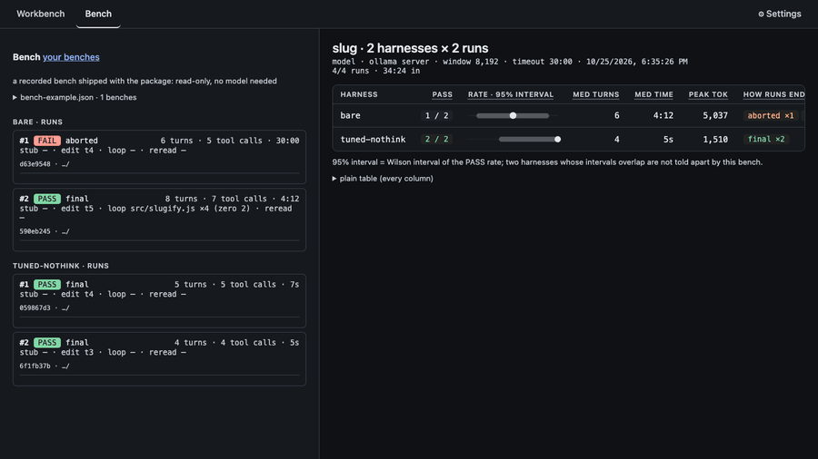
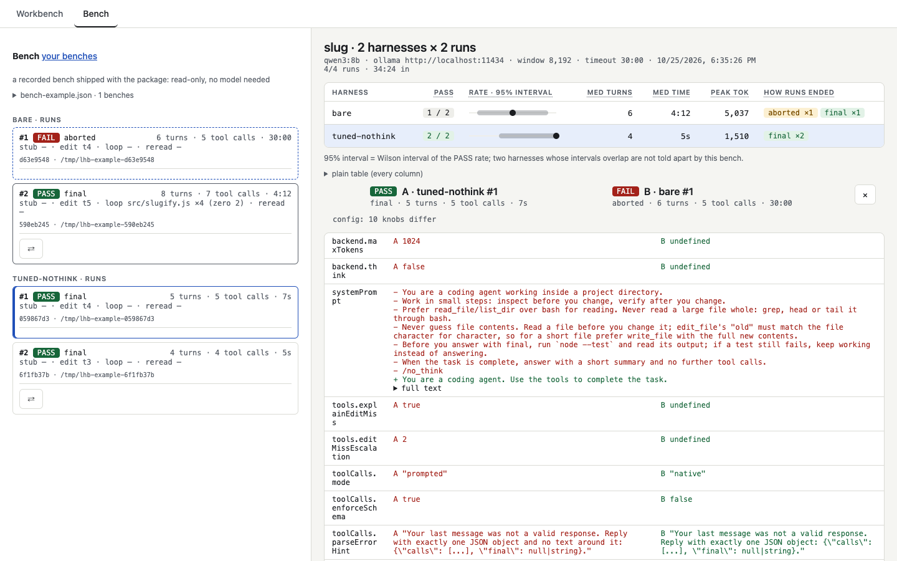

[English](README.md) · **Українська**

<div align="center">

# llm-harness-builder

**Подивіться, що ваш агентний харнес насправді надсилає моделі — локальній чи хмарній — і чому він ламається.**

[](https://www.npmjs.com/package/llm-harness-builder)
[](https://github.com/bambooplanedev/llm-harness-builder/actions/workflows/ci.yml)
[](https://nodejs.org)
[](LICENSE)



</div>

Агентний харнес — це код довкола моделі: системний промпт, інструменти, які вона може викликати, і
цикл, що повертає їй результати. Це невеликий верстат для модельного шару такого харнесу: системний
промпт, формат опису інструментів, нативні чи промптові виклики, примус до схеми, обрізання виводу
інструментів, бюджет контексту. Кожен прогін — JSONL-трейс того, що саме пішло до моделі і що
повернулося.

Це не агент для щоденного кодування. Це лабораторія, щоб зрозуміти, чому ваша 8B-модель ламається.

Щоб подивитися, модель не потрібна: `npx llm-harness-builder`, потім **Почніть звідси** → **PASS**.
Трейс — це один рядок JSON на подію; ось хід 3 того прогону, скорочено:

    {"seq":13,"turn":3,"type":"llm_request","payload":{…}}
    {"seq":14,"turn":3,"type":"llm_response","content":"{\"calls\": [{\"name\": \"read_file\", \"args\": {\"path\": \"src/slugify.js\"}}], \"final\": null}","usage":{"promptTokens":871,"completionTokens":30}}
    {"seq":15,"turn":3,"type":"tool_call","call":{"callId":"c3","name":"read_file","args":{"path":"src/slugify.js"}}}
    {"seq":16,"turn":3,"type":"tool_result","callId":"c3","name":"read_file","output":"export function slugify(s) {\n  return s.toLowerCase()…","truncated":false,"error":false}
    …
    {"seq":28,"turn":5,"type":"done","reason":"final","text":"Fixed slugify.js to strip leading and trailing dashes, and all tests passed.","turns":5,"toolCallCount":5}

і з чого складався запит цього ходу, як його друкує інтерфейс (промптовий режим, тож описи
інструментів — частина системного промпту; кожну частку округлено окремо):

    system + tools 75% · history 15% · tool results 11% · 871 tok

**Що знайдено досі** — щоразу одна модель і одна задача, мала вибірка ([як читати](#як-читати-результати)):

1. **Thinking з'їв ліміт відповіді.** `tuned` 0/2 (`parse_failed`); саме лише вимкнене thinking —
   0/2 (`max_turns`, той самий невдалий `edit_file`); `tuned-nothink` — вимкнене thinking плюс
   `explainEditMiss` і `editMissEscalation: 2` — 5/5. qwen3:8b на Ollama, `slug`.
   ([таблиця](#швидкий-старт))
2. **Правило в промпті спрацювало краще за те саме правило в коді.** «Прочитай файл, перш ніж
   змінювати» реченням: 5/5; запобіжником у коді без речення: 0/5, наступний промах повторювався
   до `max_turns`. ([Read before edit](docs/findings.md#read-before-edit) (англійською))
3. **Пояснення промаху редагування вкоротило петлю; модель ним так і не скористалася.** Одинадцять
   однакових невдалих викликів поспіль стали сімома; показано 16 разів, використано 0.
   ([Explaining an edit miss](docs/findings.md#explaining-an-edit-miss) (англійською))
4. **Бюджет контексту втримав вікно, але коштував успішних прогонів.** `pool2` на вікні 5120: без
   бюджету прогін помер на 5344 токенах; з `budgetTokens` 2670 тримався не вище 3364, PASS 1/3, а з
   позначкою 0.75·B, що є в пакеті, — 0/3. Qwen3-8B на llama-server.
   ([The measurement, on `pool2`](docs/findings.md#the-measurement-on-pool2) (англійською))
5. **Детектор повтору зупиняє петлю, але не лікує її.** `loop.maxRepeats` обірвав петлю на ході
   12 за 57 с, де `guard-only` пройшов 15 ходів; на відтвореному фліп-флопі всі десять відповідей,
   зі старими примітками чи з новими, були тим самим відкатом.
   ([Noticing a repeated call](docs/findings.md#noticing-a-repeated-call) (англійською))

## Зміст

- [Можливості](#можливості)
- [Вимоги](#вимоги)
- [Встановлення](#встановлення)
- [Швидкий старт](#швидкий-старт)
- [Використання](#використання) — [веб-інтерфейс](#веб-інтерфейс) · [CLI](#cli) · [запис іншого агента](#запис-іншого-агента)
- [Налаштування](#налаштування) — [файл харнесу](#файл-харнесу) · [бекенди](#бекенди) ·
  [хмара](#хмара) · [Anthropic](#anthropic) · [сімейства моделей](#сімейства-моделей) · [MCP](#mcp)
- [Як читати результати](#як-читати-результати) · [Висновки](#висновки)
- [Обмеження](#обмеження)
- [Розробка](#розробка)
- [Ліцензія](#ліцензія)

## Можливості

- **Трейси всього.** Кожен запит таким, яким його надіслано, і кожна відповідь такою, якою вона
  прийшла, — один JSONL-файл на прогін у `./runs`, однаково з інтерфейсу і з CLI.
- **Workbench.** Редагуйте харнес у формі, запускайте його на теці, дивіться потік ходів наживо і
  схвалюйте кожну команду.
- **Bench.** Запустіть кілька харнесів на одній задачі багато разів і отримайте частки PASS з 95%
  інтервалами Вілсона — вердикт дає скрипт перевірки, а не погляд на вивід.
- **Diff.** Порівняйте два прогони бенча: які ручки конфігу відрізняються, обидва шляхи хід за ходом
  і де вони розходяться.
- **Повтор і аналіз.** Надішліть записаний запит ще N разів і подивіться, куди піде наступний виклик;
  прочитайте з трейсів, що і коли забрав бюджет контексту.
- **Записувальний проксі.** Поставте його між іншим агентом (opencode, Claude Code) і його сервером —
  і його розмови теж стануть трейсами.
- **Локально і в хмарі.** Ollama, llama-server, LM Studio, vLLM, будь-який OpenAI-сумісний API з
  ключем (OpenRouter) і Anthropic Messages API.
- **MCP.** Інструменти з MCP-серверів через stdio, поряд із п'ятьма вбудованими або замість них.

## Вимоги

- Node.js 22.12 або новіший.
- Сервер моделі: [Ollama](https://ollama.com), llama-server (`--jinja` для нативних викликів
  інструментів), LM Studio, vLLM або ключ хмарного API.

## Встановлення

Щоб спробувати, нічого встановлювати не треба — `npx` завантажить сам (версію можна закріпити:
`npx llm-harness-builder@0.4.0`):

    npx llm-harness-builder --help

Або встановіть глобально:

    npm install -g llm-harness-builder

Або як dev-залежність проєкту, а запускайте через `npx`:

    npm i -D llm-harness-builder@0.4.0
    npx llm-harness-builder

Без реєстру npm — з архіву на сторінці [релізу на GitHub](https://github.com/bambooplanedev/llm-harness-builder/releases):

    npm i -g https://github.com/bambooplanedev/llm-harness-builder/releases/download/v0.4.0/llm-harness-builder-0.4.0.tgz

У контейнері, лише для CLI — тоді команди, які запускає модель, виконуються всередині контейнера, а
не на вашій машині:

    docker run --rm -it -v "$PWD":/work -w /work node:22.12-slim npx llm-harness-builder …

Сервер моделі на хості доступний за `http://host.docker.internal:11434` (на Linux додайте
`--add-host=host.docker.internal:host-gateway`), а не 127.0.0.1. Інтерфейс із контейнера недоступний: `serve` слухає 127.0.0.1. Із вихідного коду — див.
[Розробка](#розробка).

## Швидкий старт

    ollama pull qwen3:8b                                 # once; needs Ollama running
    npx llm-harness-builder demo --model qwen3:8b
    npx llm-harness-builder                              # opens the workbench UI

Із будь-чим, що говорить мовою OpenAI API (llama-server, LM Studio, vLLM):

    npx llm-harness-builder demo \
      --kind openai --base-url http://127.0.0.1:8080/v1 \
      --model unsloth/Qwen3-8B-GGUF:Q4_K_M

`demo` запускає ту саму задачу по разу з кожним із трьох харнесів — `bare`, `tuned-nothink` і
`tuned-hermes` — на тій самій моделі й друкує PASS/FAIL за скриптом перевірки. На хмарному API
(`--kind openai` з `--api-key-env`, наприклад OpenRouter) замість `tuned-nothink` іде `tuned`, бо
такий API відхиляє `backend.think`. `bench` повторює це й видає частки PASS:

    npx llm-harness-builder bench --n 5 \
      --kind openai --base-url http://127.0.0.1:8080/v1 \
      --model unsloth/Qwen3-8B-GGUF:Q4_K_M

Від нуля до першого PASS:

1. Встановіть [Ollama](https://ollama.com) і запустіть її.
2. `ollama pull qwen3:8b`
3. `npx llm-harness-builder demo` — або відкрийте інтерфейс і пройдіть «Почніть звідси».

Почніть із `demo`: це кілька хвилин, і ви побачите трейс та переконаєтеся, що бекенд живий.
`bench --n 5` на установці з [Bench results](docs/findings.md#bench-results) (англійською) тривав 96 хвилин,
здебільшого на `bare`.

Немає GPU? Див. [Хмара](#хмара): безкоштовного акаунта OpenRouter досить для демо.

Спробуйте руками: у [наборі вправ](https://github.com/bambooplanedev/llm-harness-builder/tree/main/docs/lab) три короткі вправи, одна з них — без моделі.

Чому `tuned-nothink`, а не `tuned`:

| харнес | чим відрізняється від `tuned` | PASS | чим закінчилися прогони | час на прогін |
|---|---|---|---|---|
| `tuned` | — (thinking увімкнено, як за замовчуванням у моделі) | 0/2 | `parse_failed` ×2: thinking з'їдає ліміт у 1024 токени, відповіді порожні | — |
| `tuned` + `think: false` | thinking вимкнено | 0/2 | `max_turns` ×2: той самий невдалий `edit_file` знову і знову | — |
| `tuned-nothink` | thinking вимкнено, `explainEditMiss`, `editMissEscalation: 2` | 5/5 | `final` ×5 | 5–18 с |
| `bare` | однорядковий промпт, нативні виклики, без ліміту відповіді й обмежень виводу | 2/4 | за три бенчі; два прогони обірвано на 1800 с після нескінченної генерації | — |

qwen3:8b на Ollama (ноутбук з RTX 4070), задача `slug`, n = 2–5: ця модель на цій задачі, мала
вибірка. `tuned` падає на моделі, що думає, бо його `maxTokens: 1024` покриває й thinking: qwen3 на
Ollama думає, якщо їй не сказати інакше, витрачає на це весь ліміт і повертає порожню відповідь.

## Використання

### Веб-інтерфейс

    npx llm-harness-builder serve [--port 7331] [--no-open]

Запуск пакета без команди робить те саме. На сторінці дві вкладки:

- **Workbench** запускає один харнес на теці й показує його трейс. Поточний хід іде наживо:
  `<think>` і відповідь з'являються в міру генерації, з приблизним лічильником `~N tok`. У трейсі
  лишається одна `llm_response` на хід; живий текст не зберігається. Назви полів у формі мають
  підказки при наведенні, англійською або українською: мову сторінки вибирає кнопка **Налаштування**
  праворуч від вкладок (за замовчуванням — мова браузера). Назви полів лишаються англійськими, як у
  файлі харнесу і в CLI.
- **Bench** показує прогін `bench` — і той, що досі йде в іншому терміналі, і давно завершений: його
  таблицю, живий трейс поточного прогону і **Run bench again**, що повторює його в новий JSON.
  Натисніть `⇄` на прогоні, щоб порівняти його з відкритим: які ручки конфігу відрізняються, шлях
  обох хід за ходом з позначкою першого розходження, і скільки часу й токенів коштував кожен хід.



Над кожним трейсом смуга показує по стовпчику на запит: висота — токени промпту, кольори — шари;
клік відкриває цей хід. Кожен запит у трейсі має той самий розклад рядком: системний промпт, описи
інструментів, історія і результати інструментів, виміряні в символах і масштабовані до
`prompt_tokens` сервера. Коли сервер не надіслав usage, число — оцінка і починається з «≈». У
промптовому режимі описи інструментів входять у системний текст, тож обидва показано одним шаром
`system + tools`, а результати, які він повертає текстом користувача, все одно рахуються як
результати інструментів. Блоки thinking від Anthropic не входять у жоден шар, і рядок про це каже.

`?film=1` (наприклад, `http://127.0.0.1:7331/?film=1`) — для зйомки чи показу екрана: більший,
контрастніший шрифт, а назви моделей, адреси серверів і шляхи під /tmp, /Users, /home, /var,
/private на екрані замінено. Файли трейсів не змінюються. Це зручність для показу екрана, **а не захист приватності**: текст, якого
режим не розпізнає, видно як є, а запит на схвалення показує команду точно такою, якою вона
виконається.

Під час першого відкриття, поки прогонів ще немає, **Почніть звідси** у списку Runs веде через три
кроки: відкрити записаний прогін PASS і прогін FAIL, відкрити приклад бенча, потім зробити власний
прогін. **Examples** відкриває записані прогони й бенч, що постачаються з пакетом: лише для
читання, модель не потрібна.

- **Create demo project** робить свіжу копію демо-задачі в тимчасовій теці й ставить на неї
  workdir; після прогону **Check** запускає `node --test` на коді, який написала модель, і показує
  PASS або FAIL. Вердикт видно лише на сторінці, у трейс він не пишеться.
- **Advanced** згортає рідші ручки форми. Нічого не прибрано, а згорток показує, скільки з них
  задано. Кожен харнес із пакета має `description`, що видно поряд із вибором харнесу.
- **New bench** на вкладці Bench запускає бенч зі сторінки: харнеси з `./harnesses`, задача, `--n`
  і модель із форми Workbench. **Stop bench** зупиняє його так само, як Ctrl-C: завершені прогони
  лишаються в JSON.

Кожен прогін, з інтерфейсу чи з CLI, зберігається в `./runs/*.jsonl`. Запускайте `serve` з тієї ж
теки, щоб їх переглядати, і оновлюйте список після прогону з CLI. При кожному старті `serve` додає
харнеси з `harnesses/` пакета, яких бракує в його робочій теці, і ніколи не перезаписує наявні файли;
`bench` і `demo` беруть файл із пакета.

### CLI

    llm-harness-builder --help | --version | help <command>
    llm-harness-builder serve [--port 7331] [--no-open]
    llm-harness-builder run <harness.json> --workdir <dir> "task" [--yes] [--json] [--answer-schema file.json] [--model m] [--base-url u] [--kind k] [--api-key-env NAME]
    llm-harness-builder demo [--model m] [--base-url u] [--kind k] [--api-key-env NAME]
    llm-harness-builder bench [harness.json ...] [--n 3] [--timeout 1800] [--out runs/bench-<ts>.json] [--task slug|pool|pool2|pool3|sift|triage|judge] [--size N] [--max-turns N] [--model m] [--base-url u] [--kind k] [--api-key-env NAME]
    llm-harness-builder replay <run-id | trace.jsonl> --turn N --base-url u --kind k [--api-key-env NAME] [--n 5] [--temperature t] [--max-tokens m] [--json]
    llm-harness-builder analyze <bench.json | run-id | trace.jsonl> ... [--json]
    llm-harness-builder proxy [--upstream http://127.0.0.1:8080] [--port 8090] [--name label]

| команда | що робить |
|---|---|
| `serve` | веб-інтерфейс |
| `run` | один харнес, одна задача, одна тека |
| `demo` | демо-задача по разу на кожен харнес із пакета |
| `bench` | задача `--n` разів на харнес, з таблицею часток PASS і JSON |
| `replay` | один записаний запит, надісланий ще `--n` разів |
| `analyze` | що прибрав бюджет контексту і що модель робила після цього |
| `proxy` | записує розмови іншого агента як трейси |

`--help` перелічує команди, `<command> --help` (або `help <command>`) — опції однієї з них, а
`--version` друкує встановлену версію.

**Коди виходу.** 0 для довідки. `run` виходить з 0, коли модель закінчила фінальною відповіддю (з
`--answer-schema` — такою, що розбирається як JSON), і з 1, коли ні; `demo` і `bench` виходять з 0
за будь-яких вердиктів; `demo` виходить з 1, коли сервер не запущено, на ньому немає моделі або харнес потребує того, чого
модель не вміє (ручка, яку вона відхиляє), і
підказує, що робити. 2 — для аргументу, якого команда не приймає (повідомлення його називає, далі
йде usage), для файлу, який не вдається прочитати, для змінної з ключем, яка не задана, порожня або
містить те, чого в ключі бути не може (див. [Хмара](#хмара)), і для відмови, описаної нижче. 130 —
для Ctrl-C у `run`, `demo` і `bench`, що зберігає трейс. `proxy` виходить з 0, коли його зупинено.

**Схвалення.** `run` без `--yes` питає перед кожною командою, яку може виконати. Коли stdin — не
термінал (пайп, `/dev/null`, CI), відповісти нікому, тож харнес, який може спитати (`approveBash` з
увімкненим `bash`, `loop.untilBash`, будь-які `mcpServers`), відхиляється ще до першого запиту, а
`yes | run …` за вас не відповість: передайте `--yes`. `demo` і `bench` не питають ніколи: вони
схвалюють і команди моделі, і `mcpServers` та `loop.untilBash` з файлів харнесів, і кажуть про це в
stderr.

#### run

`--json` пише потік подій як JSONL у stdout; людський прогрес іде в stderr. `--answer-schema`
описано в розділі [Файл харнесу](#файл-харнесу).

#### bench

`bench` запускає задачу (за замовчуванням `slug`, ту саму, що й у демо) `--n` разів на харнес по
колу, з `--timeout` на прогін у секундах. Без файлів він бере `bare`, `tuned-nothink` і
`tuned-hermes` (на хмарному API `tuned` замість `tuned-nothink`, як і `demo`) з `./harnesses` (копій,
які зробив `serve`, тобто того, що ви редагували в інтерфейсі) або з пакета. Він друкує таблицю
часток PASS і пише JSON у `runs/` після кожного прогону, тож Ctrl-C зберігає завершене.

Поряд з кожною кількістю PASS таблиця друкує її 95% інтервал Вілсона: 1/3 — це 0.06–0.79, а 3/3 —
0.44–1.00, тож при `--n 3` навіть 3/3 проти 1/3 не розрізняє двох харнесів. JSON містить повний
конфіг кожного харнесу і для кожного прогону `reason`, `parseErrors`, `toolErrors`, `lastError`,
пікові токени, тимчасовий `workdir` і `trace` (`runs/<id>.jsonl` прогону), тож два файли можна
порівнювати за конфігом, а не за назвою.

**Попередня перевірка.** Перед першим прогоном `bench` питає кожен сервер, що той уміє, нічого не
генеруючи. Сервер, що не відповідає або не має моделі, зупиняє бенч з кодом виходу 2 і без JSON.
Назва моделі перевіряється лише там, де сервер обслуговує за назвою: Ollama (`qwen3` означає
`qwen3:latest`) і роутер llama-server. llama-server з однією моделлю відповідає на будь-яку назву.
На llama-server вікно і збірка беруться з `/props`; роутер повідомляє їх для кожної моделі на
`/props?model=`, що завантажує модель, якщо вона ще не завантажена. На Ollama вікно — це `numCtx`
харнесу. Обидва потрапляють у JSON як `server` кожного харнесу, а `budgetTokens`, який разом із
`maxTokens` перевищує вікно, отримує попередження — бюджет не втримає такий прогін у межах вікна. У
LM Studio і vLLM `/props` немає: вікно невідоме, попередження немає. З ключем модель звіряється зі
списком хмарного API, якщо тільки список не каже, що він неповний, і вікно береться з цього списку —
див. [Хмара](#хмара).

**Задачі.** `--task` вибирає іншу задачу, і кожній задачі, крім `slug`, потрібен `--size`.

| задача | розміри | що це |
|---|---|---|
| `slug` | — | демо: знайти звіт про баг у довгому лозі, виправити `src/slugify.js`, домогтися проходження `node --test` |
| `pool`, `pool2` | 1–10 | десять маленьких модулів з багами, з кожним розміром їх більше; див. [The pool task](docs/findings.md#the-pool-task) (англійською) |
| `pool3` | 1–10 | `pool2` з двома закритими дірками в оракулі (нижче); на ньому ще нічого не міряно |
| `sift` | 1–12 | розкласти вердикти скринера у два файли, перевірка символ за символом |
| `triage` | 1–12 | записати KEEP або DROP для кожного нового допису у файл; фікстура містить ключ |
| `judge` | 1–12 | те саме судження одним запитом: дописи в тексті задачі, вердикти — у фінальній відповіді |

`pool3` має той самий порядок і ті самі джерела з багами, що й `pool2`, і власні тести для
`parseDuration` (хвилини окремо і поряд з іншими одиницями, тож виправлення, яке робить виняток для
літерала зі старого тесту, падає) і `median` (вхідний масив має повернутися таким, яким був, тож
сортування на місці падає). При `--size 7` вони відрізняються лише `parseDuration`; `median` — восьмий
модуль. Його рядки не порівнюються з рядками `pool2`. `sift`, `triage` і `judge` — кроки куратора
новин на синтетичних фікстурах (`examples-sift`, `examples-triage`). Як їх міряли і що це показало:
[docs/curator.uk.md](docs/curator.uk.md).

#### replay

`replay` бере запит, який записаний прогін надіслав на ході N (`runs/<id>.jsonl` зберігає кожен), і
надсилає його знову, таким, яким його було надіслано, `--n` разів; `--temperature` і `--max-tokens` —
єдине, що можна змінити. Команда друкує, скільки різних відповідей повернулося і котра з них —
записана. Відповіді порівнюються за вмістом і нативними викликами інструментів, а не за текстом
thinking чи id викликів. Жоден інструмент не виконується, тож повтор каже, куди на цьому ході піде
наступний виклик, і нічого не каже про те, чим закінчився б прогін.

Трейс не записує, куди надсилався прогін, звідси `--base-url` і `--kind`, а для хмарного API —
`--api-key-env`; хмарний API отримує записаний запит таким, яким його записано: прогін із ключем
записав лише поля OpenAI, а локальний трейс, надісланий туди, зберігає назву моделі й будь-які
`chat_template_kwargs`. Сервер мусить мати те саме вікно, що й прогін; замале відхилить запит.

<details>
<summary>Які перевірки з висновків повторює ця команда</summary>

З перевірок, які висновки називають повторами, команда повторює ті, що надсилали записаний запит без
змін: хід петлі `pool2` і нешкідливий хід під `repeatTemperature`
(`replay 153d3718 --turn 8 --temperature 1 --n 10`, і так само `411812a4 --turn 6`). Вона не повторює
тих, що спершу редагували записану історію (текст стабу, примітки лічильника, якого прогін не мав),
а уривки «повторено проти 5120» — це арифметика над трейсами, без моделі. Названих тут трейсів немає
в репозиторії; команда — для ваших.

</details>

#### analyze

`analyze` читає трейси й друкує для кожного прогону, чого модель більше не побачила: хід, на якому
бюджет уперше поставив стаб, і які результати інструментів цей стаб прибрав, хід першого вдалого
редагування, файл із найбільшою кількістю невдалих редагувань (з помилками за видами) і перший раз,
коли модель знову прочитала файл після того, як попереднє читання замінив стаб. Трейс записує кожен
запит таким, яким його надіслано, а не те, що прибрав стаб, тож стаби відтворюються порівнянням
сусідніх запитів; стаб, який не вдається пов'язати з результатами, друкується як `unmatched`, а не
вгадується. Команда приймає JSON бенчів, id прогонів і шляхи до трейсів, зокрема `.jsonl.part`;
`--json` друкує весь аналіз. Вкладка Bench показує ті самі клітинки під кожним прогоном, а трейс — над
своїм першим ходом, з `[stubbed at tN]` на кожному прибраному результаті.

### Запис іншого агента

`proxy` стоїть між агентом, якого ви не писали, і llama-server. Він пересилає кожен запит таким, яким
той прийшов, і пише кожну розмову, яку бачить, у `runs/<id>.jsonl` — той самий файл, що пише `run`.
Список Runs тоді показує запити й відповіді того агента, а `replay` бере будь-який його хід.

    llm-harness-builder proxy --upstream http://127.0.0.1:8080 --port 8090 --name opencode

Запускайте його в тій теці, де працює `serve` (обидва використовують `./runs`), і дайте агентові
`http://127.0.0.1:8090/v1` як базовий URL OpenAI. `--upstream` — корінь сервера, а не його `/v1`.
Проходить кожен шлях; записуються лише `POST …/chat/completions` і `POST /v1/messages`. Ctrl-C (або `kill`) закінчує кожен
відкритий прогін з `done: proxy_stopped`: запис зупинено, і це нічого не каже про те, як упорався агент.
Проксі відхиляє запити зі сторінки в браузері, відданої з іншого origin (включно з іншими портами
`localhost`), як і `serve`; агенти, які не є сторінками браузера, не надсилають `Origin`, і їх це не
стосується.

**Що містить файл** — це транскрипція, а не здогадка:

- `llm_request` — тіло запиту агента; `llm_response` — відповідь сервера, потокова чи ні. `usage`
  є тоді, коли сервер його надіслав: llama-server надсилає, коли агент просить, а деякі збірки —
  завжди.
- `tool_call` — запис із `tool_calls` відповіді; зберігається навіть у відповіді, обрізаній на
  max tokens (наш власний прогін такі відкидає). Виклики, які агент робить текстом, у промптовому
  форматі, видно лише всередині `llm_response`.
- `tool_result` — повідомлення інструмента, яке агент надіслав назад у наступному запиті, зіставлене
  з викликом через id, що агент повторив. Прапорця помилки чи обрізання воно не має: проксі не може
  їх знати. Воно пишеться, коли надходить той наступний запит, тож файл читається як
  `call, call, result, result`; сторінка групує за ходами й показує так само.
- Ніколи не пишеться: `context_stats`, `parse_error`, `final_check`, `approval_required`,
  `done: final`. Поле `proxy` у рядку meta позначає такий файл.

**Де починається прогін.** Проксі ідентифікує розмову за її першим системним повідомленням і першим
повідомленням користувача, і запит із тією самою парою й не меншою кількістю повідомлень, ніж
попередній, продовжує її. Це пасує агентам, у яких перше повідомлення користувача — задача, а історія
лише росте; це не пасує aider, у якого перше повідомлення користувача — приклади редагувань. Отже:

- новий раунд тієї самої задачі й історія, яку агент стискає, починають нові прогони; повторна
  спроба лишається в тому самому;
- побічний запит із власним системним промптом — окремий короткий прогін: таким є кожне стискання
  історії в opencode. Запит на назву сесії — ні: він ніколи не перевищує трьох повідомлень і не
  залежить від задачі, тож запит назви кожної сесії за все життя проксі приєднується до одного
  прогону, відкритого першим; рядок цього прогону показує інструкцію для назви, а не задачу;
- наш власний харнес через проксі розділяється там, де він міняє ці повідомлення: хід
  `loop.repeatThinkTokens` — однохідний прогін, а `loop.freshContext` починає новий;
- дві однакові сесії одночасно перемежовуються в одному прогоні, а дві сесії тієї самої задачі одна
  за одною ділять прогін своїх однакових однорядкових побічних запитів.

**Claude Code.** Спрямуйте проксі на Anthropic, а Claude Code — на корінь проксі, а не на його `/v1`.
На старті проксі друкує два рядки: `proxy on http://127.0.0.1:<port>/v1 -> …` — базовий URL для
агентів у стилі OpenAI; Claude Code бере значення з другого,
`for Claude Code: ANTHROPIC_BASE_URL=http://127.0.0.1:<port>`, без `/v1`:

    llm-harness-builder proxy --upstream https://api.anthropic.com --name claude-code
    ANTHROPIC_BASE_URL=http://127.0.0.1:8090 claude

Працюють обидва способи входу. З ключем API задайте, як звичайно, `ANTHROPIC_API_KEY` (іде як
`x-api-key`) або `ANTHROPIC_AUTH_TOKEN` (іде як `Authorization: Bearer`). З підпискою задайте лише
`ANTHROPIC_BASE_URL`: збережений OAuth-токен і його значення `anthropic-beta` проходять без змін.

- Записується: `POST /v1/messages`, потоковий чи ні. Заголовки `x-claude-code-*` від Claude Code
  ділять сесію на окремий прогін для кожного агента — головного й кожного субагента, — і список Runs
  групує їх під їхньою сесією. Допоміжні виклики (назви, класифікатори) — примітки в головному
  прогоні, а стискання — позначка в прогоні свого агента. Без цих заголовків (старіші версії) діє
  правило першого системного й першого користувацького повідомлення, описане вище.
- Не записується: `count_tokens`, жоден інший шлях. Жоден заголовок запиту не пишеться як є; лише
  id сесії, агента, батьківського агента й тип агента з `x-claude-code-*`, очищені, потрапляють у
  рядок meta прогону, щоб групувати прогони. Ключ або токен запиту замінюється на
  `[redacted: x-api-key]` чи `[redacted: authorization]` скрізь, де він трапляється, зокрема у
  відповіді, яка його повторила; значення, коротші за 20 символів, не шукаються. Телеметрія й
  перевірка оновлень ідуть на anthropic.com напряму, не через проксі.
- `--upstream` відхиляє URL з логіном чи паролем, з query чи fragment і звичайний http на будь-що,
  крім loopback.

Claude Code надсилає ваш CLAUDE.md, пам'ять, git-ідентичність і локальні шляхи в кожному запиті, тож
вони є в трейсі. Сесію, яку покажете, записуйте з чистого профілю: тимчасовий `HOME` або
`CLAUDE_CONFIG_DIR`, без глобального CLAUDE.md і пам'яті, синтетичний репозиторій з одноразовою
git-ідентичністю. Приховати імена на екрані під час зйомки — зручність показу, а не захист приватних
даних. Записи лишаються на вашій машині; ніколи їх не комітьте.

**Сесія, що триває.** Поки проксі, який її пише, живий (його pid у рядку meta), `serve` не позначає
прогін перерваним, а сторінка підхоплює нові події кожні кілька секунд. Якщо проксі вбили, а система
віддала його pid іншому процесу, прогін показується як запущений, доки той процес не завершиться.

Як і кожен трейс, записаний містить усе, що агент прочитав, і його системний промпт, включно з
локальними шляхами. Заголовки запитів, серед них ключ API, ніколи не пишуться як є; у рядок meta
потрапляють лише описані вище id групування від Claude Code.

<details>
<summary>Перевірено з opencode: налаштування і що побачив проксі</summary>

opencode 1.18.32 (`npx opencode-ai run --pure "calc.py has a bug in add; fix it"`) на
`unsloth/Qwen3-8B-GGUF:Q4_K_M`, llama-server b11046 з `--jinja --parallel 1`, і ось це в
`opencode.json` проєкту:

    {
      "provider": {
        "lab": {
          "npm": "@ai-sdk/openai-compatible",
          "options": { "baseURL": "http://127.0.0.1:8090/v1" },
          "models": { "unsloth/Qwen3-8B-GGUF:Q4_K_M": { "name": "qwen3-8b" } }
        }
      },
      "model": "lab/unsloth/Qwen3-8B-GGUF:Q4_K_M",
      "permission": { "edit": "allow", "bash": "deny", "webfetch": "deny" }
    }

Кожен запит був потоковим і просив `usage`, який приходив у кожній відповіді. Перший запит головної
сесії — два повідомлення і вісім інструментів, близько 8 900 токенів, тож opencode не вміщається у
вікно 4096, яке використовують інші перевірки тут. При `-c 4096` сервер його відхилив; opencode
сприйняв відмову як завеликі вкладення і стискав історію знову і знову — дев'ять прогонів за п'ять
хвилин, поки його не зупинили. При `-c 16384` він виправив баг за три ходи (`read`, `edit`, потім
нічого), записані як головний прогін плюс однохідний прогін назви. Третій хід варто відкрити: модель
написала свій наступний виклик `read` всередині thinking, сервер не знайшов у відповіді виклику
інструмента, і opencode сприйняв це як кінець. `replay` ходу `edit` дав записаний виклик 2 рази з 2.
Це одна модель на одній задачі: вона каже, що проксі записує те, що надсилає opencode, а не те, як
opencode працює на локальних моделях.

Чи вартий той третій хід ручки — витягати виклик із thinking — перевірили через `replay`: кожен хід
тієї сесії надіслано десять разів таким, яким його записано. Перші два ходи дали справжній виклик
десять разів із десяти: `read`, потім `edit`. Третій, після виправлення, сім разів дав фінальний
текст і тричі — `read` всередині thinking. Жоден із 197 попередніх трейсів у `runs/` не має
відповіді, що закінчилася викликом у thinking. Тож на цій моделі й задачі виклик ішов у thinking лише
на ході, який перевіряє завершену роботу, і ніколи на робочому ході (0 з 20), і ручки для цього не
зробили. Про інші моделі це нічого не каже.

</details>

## Налаштування

### Файл харнесу

Харнес — це один JSON-файл: бекенд, промпти, інструменти, ліміти. Почніть з
[`harnesses/tuned.json`](harnesses/tuned.json):

```json
{
  "name": "tuned",
  "backend": { "kind": "ollama", "baseUrl": "http://localhost:11434", "model": "qwen3:8b", "numCtx": 8192, "maxTokens": 1024, "temperature": 0.2 },
  "systemPrompt": "…",
  "tools": { "enabled": ["list_dir", "read_file", "write_file", "edit_file", "bash"], "approveBash": true },
  "toolCalls": { "mode": "prompted", "enforceSchema": true, "promptedTemplate": "…{{tools}}…", "parseErrorHint": "…" },
  "context": { "maxToolOutputChars": 4000, "budgetTokens": 0 },
  "loop": { "maxTurns": 15 }
}
```

Він переносний: жодних шляхів на вашій машині; `workdir` і задача — параметри прогону. Ключ, якого
формат не має, — помилка, що його називає, на верхньому рівні, в кожній секції і в кожному записі
`mcpServers`: кожна необов'язкова ручка вимкнена, коли її немає, тож ручка з одруківкою інакше була
б тихо вимкнена.

| ключ | що робить |
|---|---|
| `backend.kind`, `baseUrl`, `model` | куди йдуть запити — див. [Бекенди](#бекенди) |
| `backend.temperature` | температура семплювання |
| `backend.numCtx` | вікно контексту, надсилається лише в Ollama |
| `backend.maxTokens` | обмежує токени однієї відповіді, включно з thinking; без нього генерація йде, доки не заповниться вікно |
| `backend.think` | перемикач thinking у шаблоні чату (нижче) |
| `backend.apiKeyEnv` | змінна, що містить ключ хмарного API — див. [Хмара](#хмара) |
| `backend.pricePerMTok` | ціни за мільйон токенів, для `$` за відповідь і за прогін — див. [Anthropic](#anthropic) |
| `description` | один рядок про те, для чого харнес; видно поряд із вибором, diff його ігнорує |
| `systemPrompt` | перше повідомлення кожного запиту |
| `tools.enabled` | вбудовані інструменти: `list_dir`, `read_file`, `write_file`, `edit_file`, `bash` |
| `tools.approveBash` | питати перед кожною командою `bash` |
| `tools.requireReadBeforeEdit` | відмовляти в редагуванні файлу, який прогін не читав |
| `tools.explainEditMiss` | пояснювати, чому редагування не збіглося |
| `tools.editMissEscalation` | після N невдалих редагувань одного файлу казати моделі прочитати його знову (нижче) |
| `tools.readMaxBytes`, `bashMaxBytes`, `bashTimeoutS` | ліміти процесу; за замовчуванням 4194304, 1048576 і 30 |
| `tools.bashEnv` | назви змінних середовища, які `bash` отримує з вашого (нижче) |
| `toolCalls.mode` | `native` (інструменти в API) або `prompted` (інструменти в тексті) |
| `toolCalls.format` | `json` або `hermes`, у промптовому режимі |
| `toolCalls.enforceSchema` | тримати відповідь у JSON-схемі на сервері |
| `toolCalls.promptedTemplate`, `parseErrorHint` | текст промптового режиму і його повторної спроби |
| `context.maxToolOutputChars` | обрізати кожен результат інструмента до стількох символів |
| `context.budgetTokens` | після перевищення бюджету замінювати стабами найстаріші результати інструментів до трьох чвертей бюджету |
| `loop.maxTurns` | прогін закінчується як `max_turns` після стількох ходів |
| `loop.maxRepeats` | виклик, повторений більше разів, ніж це число, закінчує прогін як `repeat_loop` |
| `loop.freshContext`, `repeatTemperature`, `repeatThinkTokens` | способи вийти з петлі — див. [висновки](docs/findings.md#three-ways-out-of-a-loop) (англійською) |
| `loop.untilBash` | фінальна відповідь закінчує прогін лише тоді, коли ця команда виходить з 0 |
| `mcpServers` | інструменти з MCP-серверів — див. [MCP](#mcp) |

**Контекст.** `context.maxToolOutputChars` і `context.budgetTokens` необов'язкові, як і сам
`context`. Без них харнес це не обмежує: вивід інструментів не обрізається, і жоден бюджет не
замінює старі результати стабами (`budgetTokens: 0` теж означає «без бюджету», тож старі файли
працюють). Якщо вони є, то мусять бути додатним цілим і невід'ємним цілим.

**Thinking.** `backend.think` задає `chat_template_kwargs.enable_thinking` на OpenAI-сумісному
сервері (llama-server його читає) і `think` в Ollama. Без нього нічого не надсилається і діє
власне замовчування моделі, тож харнес без цього ключа надсилає той самий запит, що й завжди. Він
для моделі, яка думає, якщо їй не сказати інакше через шаблон; рядок `/no_think` у харнесах із
пакета — конвенція Qwen3, інше сімейство його не читає. З `loop.repeatThinkTokens` хід із thinking
іде з увімкненим перемикачем, хай би що казав `think`.

**Промптовий режим.** З `format: "json"` модель відповідає
`{"calls":[{"name":...,"args":{...}}],"final":null|"text"}`, а `enforceSchema` передає цю форму як
`response_format` / `format`. З `hermes` вона пише блоки
`<tool_call>{"name":…,"arguments":…}</tool_call>`, отримує результати в `<tool_response>`, а відповідь
звичайним текстом означає «готово»; `enforceSchema` стосується лише `json`.

**Схема для фінальної відповіді.** У режимі `native` `enforceSchema` робить ще одне, і лише в
харнесі зовсім без інструментів (`tools.enabled` порожній, жодних `mcpServers`): коли в задачі є
схема для фінальної відповіді (задача `judge` у `bench` має), запит її несе, і сервер тримає
відповідь у ній. Такий прогін — один запит. З будь-яким увімкненим інструментом схема не
надсилається: це форма фінальної відповіді, а не ходів перед нею. `run --answer-schema <file.json>`
дає таку схему вашій власній задачі. З харнесом, який її не надіслав би, `run` зупиняється до
будь-якого запиту й пояснює чому. Примус робить сервер, а сервер може ігнорувати це поле, тож із
прапорцем `run` виходить з 0 лише тоді, коли фінальна відповідь розбирається як JSON. Чи цей JSON
відповідає схемі — вирішувати тому, хто викликає. Відповідь — це `text` події `done` у `--json`.

**Промахи редагування.** `tools.editMissEscalation: N` рахує невдалі виклики `edit_file` для кожного
файлу відтоді, як цей файл востаннє прочитали чи змінили через інструмент. Починаючи з N-го, помилка
закінчується на `note: miss #N on <path> — read the file again with read_file before editing it, or
rewrite it with write_file`. `read_file` цього файлу, вдале редагування чи запис його, або скидання
`freshContext` починають лік спочатку; відмова запобіжника «читай перед редагуванням» не
рахується, у неї свій текст. Ідея — з Hermes Agent (його лічильник промахів на файл у
`tools/file_operations.py`), а підстава тут — підрахунок 2026-10-10 у
[висновках](docs/findings.md#a-second-model-2026-10-09) (англійською): на `pool2` прогони, що знову читали файл,
на якому зациклилися, проходили значно частіше. Це збудовано, але не виміряно. Якщо порахувати по
записаних трейсах без моделі, `N = 3` спрацював би в 36 із 166 прогонів, що хоч щось редагували, — а
що модель зробила б далі, може сказати лише прогін.

**Ліміти.** `tools.readMaxBytes`, `tools.bashMaxBytes` і `tools.bashTimeoutS` захищають процес:
скільки файлу повертає `read_file`, скільки виводу `bash` зберігається і коли команду вбивають.
Кожен — додатне ціле; пропущений ключ лишає своє замовчування. `read_file`, обрізаний на стелі,
закінчується на `[truncated at N bytes]`; `loop.untilBash` використовує ті самі ліміти `bash`.

**Середовище.** `tools.bashEnv: ["NAME", ...]` називає змінні середовища, які `bash`,
`loop.untilBash` і перевірки задач у `bench` та `demo` отримують з вашого, — лише назви; файл
харнесу ніколи не задає значення. Без нього вони отримують `PATH`, `HOME`, `LANG`, `LC_ALL`,
`LC_CTYPE`, `LC_COLLATE`, `LC_MESSAGES`, `LC_MONETARY`, `LC_NUMERIC`, `LC_TIME`, `TERM` і `TMPDIR` і
більше нічого: `TZ`, `HTTPS_PROXY`, `NODE_EXTRA_CA_CERTS`, `CI` і кожен ключ зникають, якщо їх не
назвати. MCP-сервери цього не стосується: вони стартують із повним середовищем цього процесу, крім
змінної, яку називає `backend.apiKeyEnv`. `run`, `demo` і `bench` друкують назви в stderr на старті,
а інтерфейс показує їх під інструментами. Значення, яке друкує команда, потрапляє в `runs/` і в
наступний запит до бекенду — крім значення самого ключа бекенду, яке маскується (про межі див.
[Хмара](#хмара)). Це не дає ключам випадково потрапити у вивід команди; це не пісочниця — див.
[чесні примітки](docs/honest-notes.uk.md).

### Бекенди

- `kind: "ollama"` говорить із рідним `/api/chat` Ollama, тож `num_ctx` враховується.
  OpenAI-сумісний `/v1` Ollama ігнорує `num_ctx` і мовчки обрізає промпт.
- `kind: "openai"` працює з llama-server (для нативних викликів інструментів потрібен `--jinja`),
  LM Studio, vLLM і всім іншим, що обслуговує `/v1/chat/completions`. З `backend.apiKeyEnv` він
  говорить із хмарним API на кшталт OpenRouter — див. [Хмара](#хмара).
- `kind: "anthropic"` говорить із Messages API — див. [Anthropic](#anthropic).

**Ручки, яких модель не приймає.** Деякі моделі відмовляються від налаштування, яке є у файлі
харнесу. Файл зберігає значення, ручка просто не надсилається, і `run` каже про це рядком на кожну
ручку: `temperature 0.2 not sent: <reason>`. Для OpenRouter список береться з
`supported_parameters` моделі, для Ollama — з `/api/show`. Список OpenRouter — це об'єднання по
провайдерах, які обслуговують модель, тож ручка, якої в ньому немає, надійно не підтримується, а
наявна не гарантує, що її прийме провайдер, до якого дійде ваш запит. У формі ручка блокується з
написом «this knob is not available for this model» (Ollama питають про модель, коли її
підтверджено в полі, інших — на ↻) і розблоковується, коли ви вибираєте іншу модель. Ручка, яка
змінила б сам харнес, не відкидається, а відхиляється до першого запиту: `toolCalls.mode: "native"`
на моделі, сервер якої каже, що вона не приймає інструментів, і `enforceSchema` на моделі, яка не
приймає схеми відповіді (з тих самих джерел). Повідомлення називає виправлення: задайте
`toolCalls.mode: "prompted"` або `toolCalls.enforceSchema: false`.

### Хмара

Харнес говорить із хмарним OpenAI-сумісним API, коли його бекенд називає змінну середовища, що
містить ключ:

    "backend": { "kind": "openai", "baseUrl": "https://openrouter.ai/api/v1",
                 "apiKeyEnv": "OPENROUTER_API_KEY",
                 "model": "nvidia/nemotron-3.5-super-vl:free", "temperature": 0.2 }

Демо в хмарі, без GPU — досить безкоштовного акаунта OpenRouter: моделі, чий id закінчується на
`:free`, нічого не коштують, але OpenRouter дозволяє їм 20 запитів на хвилину і 50 на день, доки ви
не купите 10 кредитів (станом на жовтень 2026). Безкоштовні моделі з'являються і зникають, тож якщо
цієї вже немає, виберіть іншу зі списку OpenRouter. Для платної моделі використовуйте окремий ключ
із лімітом кредитів, як радить OpenRouter:

    export OPENROUTER_API_KEY=...
    npx llm-harness-builder demo --kind openai --base-url https://openrouter.ai/api/v1 \
      --api-key-env OPENROUTER_API_KEY --model nvidia/nemotron-3.5-super-vl:free

`harnesses/tuned-openrouter.json` — це `tuned` на цьому бекенді; у старішій копії `harnesses/`, яку
зробив `serve`, його немає, тож скопіюйте його вручну.

**Куди йде ключ.** Сам ключ ніколи не буває у файлі харнесу. Він читається зі змінної на старті
команди й надсилається як `Authorization: Bearer` на `baseUrl/models` і `baseUrl/chat/completions`,
більше нікуди, і запити з ним не йдуть за перенаправленнями. Назва мусить бути у верхньому регістрі
й закінчуватися на `_API_KEY`, тож чужий файл харнесу не може відправити ваш `GITHUB_TOKEN` чи
`AWS_*`. Але він усе ще може відправити будь-яку з ваших змінних `*_API_KEY` на хост, який сам
вибере. `baseUrl` мусить бути `https` (звичайний `http` лише на `localhost`, `127.0.0.1` або
`[::1]`). `run`, `demo`, `bench` і `replay` до першого запиту кажуть у stderr, куди йде ключ —
`the key in OPENROUTER_API_KEY goes to openrouter.ai`. Це повідомлення, а не питання: ключ іде з цим
запитом (у `bench` — з його попередньою перевіркою). Змінна, яка не задана, порожня або містить те,
чого в ключі бути не може (пробіли, керівні символи, не-ASCII; пробіли на краях спершу обрізаються),
зупиняє команду з кодом виходу 2, ще до того, як щось надіслано.

**Маскування.** Значення ключа замінюється на `[redacted: OPENROUTER_API_KEY]` у виводі
інструментів, виводі `loop.untilBash` і кожній події, перш ніж їх побачать історія, трейс, термінал
чи інтерфейс, а MCP-сервери стартують без цієї змінної. [Чесні примітки](docs/honest-notes.uk.md)
перелічують, чого це не ловить, серед іншого: закодований ключ, ключ коротший за 20 символів, живий
текст ходу і команду, яка сама надсилає ключ кудись.

**Що отримує хмарний API.** Лише те, що визначає OpenAI API: без `/apply-template` і `/tokenize`, тож
кількість токенів — це оцінка поряд з `usage`, яке повідомляє кожна відповідь; без `/props`; без
`chat_template_kwargs`, тож `backend.think` із ключем — помилка: у хмарного API свій перемикач.
Попередня перевірка `bench` звіряє модель з `baseUrl/models` (суфікс маршрутизації OpenRouter на
кшталт `:nitro` при цьому відкидається) і бере вікно з цього списку: менше з `context_length` моделі
і того, що в її топ-провайдера. Список, у якого `total_count` більший за кількість надісланих
моделей, неповний, і попередня перевірка не відхиляє модель, якої в ньому немає. Список OpenRouter
публічний, тож неправильний ключ проходить попередню перевірку і проявляється як 401 на першому
запиті. Потік, що падає після свого 200 (`finish_reason: "error"` в OpenRouter), — це
`backend_error` з повідомленням провайдера, а не порожня відповідь; 429 чи 5xx закінчують прогін так
само, і нічого не повторюється. `replay --api-key-env` надсилає записаний запит у хмарний API таким,
яким його записано.

**В інтерфейсі.** `serve` читає змінну із середовища, в якому його запущено. Форма бере бекенд
завантаженого харнесу лише поки модель не вибрано, тож задайте там kind, базовий URL, змінну ключа і
модель. З ключем форма показує список моделей лише після натискання ↻, бо цей запит надсилає ключ на
базовий URL: відкриття харнесу чи прогону бенча нічого туди не надсилає. Без ключа список
з'являється сам. Форма сама вибирає модель зі списку лише тоді, коли ключа немає, а базовий URL
вказує на цю машину (`localhost`, `127.0.0.1`, `[::1]`): OpenRouter показує сотні моделей за будь-якою
ціною, і його список публічний, тож він приходить раніше, ніж ви введете ключ.

### Anthropic

`kind: "anthropic"` говорить із Messages API звичайним HTTP, без SDK. `baseUrl` — корінь сервера
(`https://api.anthropic.com`; харнес сам додає `/v1/...` і не читає `ANTHROPIC_BASE_URL`), а
`apiKeyEnv` обов'язковий. Усе сказане в [Хмара](#хмара) про ключ тут чинне: він іде лише на
`baseUrl`, без перенаправлень, і `run`, `demo` та `bench` кажуть про це до першого запиту.
`ANTHROPIC_API_KEY` часто експортовано глобально, і чужий харнес може його назвати: читайте хост у
цьому повідомленні. Харнес, бекенд якого не Anthropic, усе одно стартує свої MCP-сервери з
`ANTHROPIC_*` у середовищі.

    export ANTHROPIC_API_KEY=...
    npx llm-harness-builder bench harnesses/native-anthropic.json harnesses/budget-anthropic.json --n 1

`harnesses/native-anthropic.json` — це `bare` на Claude Haiku 5.5 з вимкненим thinking;
`harnesses/budget-anthropic.json` не задає `think` (адаптивне thinking) і додає
`context.budgetTokens: 2670` та `loop.maxRepeats: 3`, тож стаби `applyBudget` зустрічаються з
блоками thinking. Як і інші приклади, `serve` не копіює їх у старішу `harnesses/`. Запит несе
`anthropic-version: 2026-10-21`; `maxTokens` за відсутності береться з власного `max_tokens` моделі
з `GET /v1/models/{id}`, а якщо сервер його не називає, прогін просить задати його. На цій версії
API `temperature` ніколи не надсилається: це 400 на кожній моделі. Промптовий режим з
`enforceSchema` тут відхиляється, а `replay` запиту Anthropic каже «not yet».

**Thinking.** Без `think` або з `think: true` запит просить адаптивне thinking із підсумком і
задає `block_binding.prefix_mismatch_behavior` як `drop_block` (бета
`thinking-binding-controls-2026-08-01`). Стаби `applyBudget` переписують старі результати
інструментів, а на акаунтах, створених 31 серпня 2026 або пізніше, блок thinking, що більше не
збігається зі своїм префіксом, — це 400. З `drop_block` API відкидає перший такий блок і всі після
нього. Налаштування також вмикає цю перевірку для старіших акаунтів, які інакше пропускали б блоки:
там вони теж відкидаються, тож трейс означає те саме на будь-якому акаунті. `think: false` надсилає
`thinking: {type: "disabled"}`, без `block_binding` і без бета-заголовка. Модель, яка не вміє
вимикати thinking (Opus 5.5, Sonnet 5.5), відповідає 400, і трейс показує помилку бекенду.

**Кеш.** Запит завжди несе `cache_control: {type: "ephemeral"}` на верхньому рівні. На Haiku 5.5
префікс має бути щонайменше 512 токенів, щоб кешуватися.

**Скільки коштує прогін.** Задайте ціни в харнесі, за мільйон токенів:

    "pricePerMTok": { "input": 0.1, "output": 0.5, "cacheRead": 0.01, "cacheWrite": 0.125 }

Тоді інтерфейс показує `$` на кожній відповіді, рядок done у CLI закінчується на `· $X total`, а
`bench` повідомляє `med $`. Без `cacheRead` і `cacheWrite` кешовані токени рахуються за ціною
`input`. Таблиці цін у інструменті немає: ці числа були прейскурантними цінами Haiku 5.5 для
промптів до 100 000 токенів (читання з кешу — 0.1 від input, запис у 5-хвилинний кеш — 1.25) на
момент написання прикладу, і вони застарівають. Промпт понад 100 000 токенів, включно з влученнями в
кеш, рахується за другою сіткою ($0.50 input, $2.50 output), яку пласкою `pricePerMTok` не
виразити: понад цей розмір цифра занижена.

<details>
<summary>Виміряно 24 жовтня 2026</summary>

`claude-haiku-5-5`, задача `slug`, по одному прогону: ця модель на цій задачі, а не властивість
ручки. `native-anthropic.json`: PASS за 3 ходи, близько $0.0005, читання з кешу з другого ходу, і
з'явився рядок `temperature 0.2 not sent`. `budget-anthropic.json` (`budgetTokens: 2670`): PASS за 4
ходи, і жоден стаб не спрацював: харнес оцінює контекст як chars/4 (близько 460 токенів на
останньому ході), що не враховує схем інструментів, тоді як сервер нарахував близько 2000 токенів
промпту. З `budgetTokens: 200` стаби пішли з ходу 3, і 400 не було, але сервер повідомив, що кожен
блок thinking після першого стабу відкинуто (`input_transformations`: `thinking_dropped`,
`prefix_binding_mismatch`), тож модель продовжувала без своїх попередніх міркувань; PASS за 14
ходів, близько $0.0054.

На Ollama 0.40.10 `/api/show` дав `capabilities` `["completion", "tools", "thinking"]` для
`qwen3:0.6b` і `["completion"]` для `gemma3:270m` (тож нативний харнес з інструментами на останній
відхиляється), і 404 для моделі, якої в нього немає; `prompt_eval_count` на другому ході з тим самим
префіксом був цілим промптом (1234, потім 1253), тож токени промпту Ollama читаються так само, як в
інших бекендів. Не перевірено наживо: блокування у формі для моделі OpenRouter (лише тести).

Один прогін, що закінчився нулем, — це «ця модель на цій задачі», а не властивість ручки.

</details>

### Сімейства моделей

Кнопка сімейства в інтерфейсі (`applyFamily` у `src/core/prompts.ts`) заповнює режим викликів,
формат, промптовий шаблон і підказку для помилки розбору та міняє завершальний рядок сімейства в
системному промпті; потім форма каже, що змінила. Вона ніколи не чіпає бекенд, інструменти,
контекст чи налаштування циклу, і нічого про сімейство не зберігається у файлі харнесу — лише
результуючі звичайні поля.

| сімейство | режим / формат | рядок у промпті | чому |
|---|---|---|---|
| `qwen3` | prompted / hermes | `/no_think` | навчена на XML `<tool_call>`; `/no_think` не давав Qwen3-8B спалювати вікно в `<think>` (один прогін: [Isolating the knobs](docs/findings.md#isolating-the-knobs-two-more-runs) (англійською)) |
| `gemma` | prompted / json | — | у шаблоні чату немає нативних викликів інструментів (Ollama відхиляє `tools[]`); для thinking рядка не додати — Gemma, що думає за замовчуванням, перемикається через `backend.think` (Gemma 12B на llama-server: міркування на 0 з 36 ходів `sift` з `think: false`) |
| `llama3` | native / json | — | нативні виклики працюють через шаблон чату; нічого додавати не треба |

Чому промптовий формат hermes, коли llama-server (`--jinja`) і Ollama й так нативно розбирають
`<tool_call>` від Qwen: він працює без `--jinja` і на будь-якому `/v1`; зіпсований блок стає видимою
`parse_error` з підказкою і повторною спробою замість порожнього `content`; а трейс показує точний
текст, який написала модель. Якщо сервер усе ж підніме блоки в `tool_calls`, прогін використає їх, а
сира відповідь у трейсі покаже, що так сталося.

### MCP

Харнес може брати інструменти з MCP-серверів через stdio замість вбудованих п'яти або поряд із ними:

    "tools": { "enabled": ["bash"], "approveBash": true },
    "mcpServers": {
      "fs": { "command": "npx", "args": ["-y", "@modelcontextprotocol/server-filesystem", "."] }
    }

Кожен сервер стартує з `cwd`, що дорівнює `workdir` прогону, — та сама поведінка відносних шляхів,
що вже є в `bash`, — і кожен старт просить схвалення, якщо немає `--yes` (`demo` і `bench` не питають
ніколи). Назви інструментів лишаються пласкими, без префікса сервера; назва, що збігається з
вбудованою, закінчує прогін до першого запиту до моделі. `tools: [...]` сервера — це allow-list;
відсутній чи порожній означає все, що сервер пропонує.

**Стежте за allow-list.** Текст інструментів — перше, що з'їдає вікно контексту. На
`@modelcontextprotocol/server-filesystem@2026.8.31`:

| | інструменти | опис + схема | ≈ токенів | від `numCtx` 8192 |
|---|---|---|---|---|
| вбудовані (усі п'ять) | 5 | 1193 chars | ~298 | 3.6% |
| MCP-сервер як є | 14 | 7167 chars | ~1792 | **22%** |
| той самий сервер, allow-list із 4 | 4 | 1914 chars | ~479 | 5.8% |

Ушестеро більше тексту інструментів і п'ята частина вікна зникає ще до того, як модель побачила
задачу, — і це замовчування, бо allow-list ніхто не налаштовує. Структура гірша за розмір: сервер
пропонує чотири способи прочитати файл (`read_file`, позначений DEPRECATED на користь
`read_text_file`, плюс `read_media_file` і `read_multiple_files`) і три способи переглянути теку. У
пробному прогоні це не збило Qwen3-8B — `list_allowed_directories`, `list_directory`,
`read_text_file`, три виклики, без повторів, і вона послухалася позначки DEPRECATED з першого разу,
як її прочитала. Тож твердження тут таке: неналаштований MCP-сервер коштує п'ятої частини вікна, а
не те, що він збиває модель; трейс показує, який інструмент вибрала ваша.

`harnesses/mcp-off.json` і `harnesses/mcp-on.json` — два плечі: один промпт, що не залежить від
інструментів, однакові бекенд і налаштування циклу, файлові інструменти в одному — вбудовані, в
іншому — із сервера. `bash` є в обох, бо демо-задача запускає `node --test`, а файловий сервер не має
оболонки. Їх немає в наборі бенча за замовчуванням — тому наборові не має бути потрібна мережа для
`npx`, — тож запускайте їх за назвою:

    llm-harness-builder bench harnesses/mcp-off.json harnesses/mcp-on.json --n 5

Таблиця тоді отримує два стовпці: `toolChars` — що сервери поставили перед моделлю, і `med errs` —
результати інструментів, що повернулися помилками. На відміну від частки PASS, `toolChars` не
залежить від розміру вибірки: він однаковий у кожному прогоні. `med errs` — медіана по прогонах, а
сама кількість міняється від прогону до прогону, бо це те, що робила модель.

Два застереження. **Плечі відрізняються не лише розміром описів**: назви інструментів і форма
аргументів теж різні, а `read_file` з MCP приймає `head`/`tail`, чого вбудований не вміє, — подекуди
MCP сильніше плече. Тож пара міряє «MCP як цілісний спосіб давати моделі інструменти», а не «ціну
описів інструментів». І **MCP-сервер працює поза пісочницею `workdir`**: вбудовані файлові
інструменти замкнені через `resolveInside`, а сервер лише отримує теку як `cwd` і поважає її з
доброї волі.

<details>
<summary>П'ять прогонів на плече, 2026-09-13, і виправлення від 2026-09-19</summary>

На тій самій установці, що й [Bench results](docs/findings.md#bench-results) (англійською):

| харнес | PASS | чим закінчилися прогони | медіана ходів | медіана с | `toolChars` | `med errs` |
|---|---|---|---|---|---|---|
| `mcp-off` — файлові інструменти вбудовані | **5/5** | `final×5` | 5 | 31 | — | 0 |
| `mcp-on` — ті самі інструменти із сервера | **3/5** | `backend_error×2 final×3` | 5 | 45 | 6439 | 0 |

Точний тест Фішера дає для 5 проти 3 p = 0.44, тож читайте стовпець PASS як ілюстрацію, і не
більше. Трейси варті більше за підрахунок, бо обидва провали ідентичні до токена.

Кожен прогін `mcp-off` починався з 605 токенів контексту, а кожен `mcp-on` — з 1742. Промпт
незмінний, тож розрив у 1137 токенів — це текст інструментів, однаковий в усіх десяти прогонах. У
двох невдалих прогонах хід 4 розігнався до 5062 токенів завершення і повернувся з
`finish_reason=length` — це `parse_error`, що зазвичай коштує одну повторну спробу і нічого більше.
Запит повторної спроби мав 8229 токенів проти `numCtx` 8192, і llama-server відповів 400.

**Виправлення, 2026-09-19.** Раніше цей розділ робив висновок, що ціна вікна проявляється на крок
пізніше: що `mcp-off` поглинає такий самий розгін із запасом, а в `mcp-on` не лишається місця на
повторну спробу, тож «відновлювана помилка розбору стає невідновлюваним 400». Обидві половини були
хибні, і трейси, що вже лежали на диску, це показують. Жоден прогін `mcp-off` не розігнався — його
найбільше завершення за п'ять прогонів — 110 токенів, — тож поглинати не було чого. І розрив у 1137
токенів у 400 ролі не грає. Обмеження виводу не надсилається, тож відповідь, що повертається з
`finish_reason=length`, заповнила вікно точно (3130 + 5062 = 8192), а повторна спроба — та історія,
та відповідь і підказка — це 8192 + 37 токенів у будь-якому плечі, хай яким малим був би текст
інструментів. З розгоном у `content` повторна спроба, яку пропонував цей харнес, ніколи не
вмістилася б на llama-server. (Розгін усередині `<think>` повертається як `reasoning`, який ніколи
не надсилається знову, і там повторна спроба працює: це `bare` у висновках.)

Розігнався один рядок. Запит ніс граматику `enforceSchema`; обидва невдалі прогони написали заміну
як `\"\"`, загубили екранування десь на 396-му символі й закрили свій JSON, коли граматика ще
тримала їх усередині відкритого рядка, де вивід закінчуватися не може. Вони видавали `` `** `` 295
с, доки не заповнилося вікно. Три успішні прогони з того самого префікса написали `''` і впоралися
приблизно за 160 токенів. Код усередині вкладеного JSON-рядка — `edits[].newText` у MCP — імовірніший
тригер, ніж розмір описів; це перше застереження вище, і воно досі не показане. Що лишається
виміряним: 22% вікна, 1742 проти 605 токенів, і `med errs` 0 з обох боків — модель упоралася з
будь-яким набором інструментів без жодної помилки інструмента.

Відтоді обрізана відповідь більше не повертається цілою. Історія отримує
`[response cut off at the token limit: kept 0 of 7765 chars]`; трейс зберігає повний текст і каже,
скільки пропущено. Перевірено повтором записаного запиту ходу 5 одного з невдалих прогонів проти
того самого сервера з заміною лише цього повідомлення (`max_tokens: 400` лише у скрипті повтору):
3192 токени замість 8229, і відповідь розбирається, п'ять разів із п'яти — п'ять клонів за цієї
температури, тож читайте це як одну вибірку. Збереження перших 396 чи 500 символів теж розбиралося
п'ять із п'яти, але модель тоді знову писала `\"\"`; з самою лише позначкою вона писала `''`. Це
перевірка існування на одній записаній історії, а не частка PASS. Жоден прогін не повторювали, і
таблиця вище лишається такою, як виміряно; її `backend_error×2` сьогодні так само не стався б.

Друга половина — 295 с. `mcp-on`, як і кожен харнес із пакета, крім `bare` і двох кураторських
(4096), тепер надсилає `"maxTokens": 1024`. Записаний запит ходу 4, що розігнався, надіслали знову з
цим лімітом — шість разів через адаптер із пакета, тричі як звичайні непотокові запити: дев'ять
спроб, вісім із них — здорова відповідь на 162 токени, а одна розігналася знову — той самий
`` `** `` — і була обрізана на 1024 токенах через 55 с. З лімітом повторна спроба вміщається навіть
без позначки (3130 + 1024 + 37), доки промпт лишає стільки місця. Одна з дев'яти тут проти двох із
п'яти в таблиці — теж не частка; це каже, що розгін — справа семплювання, а не чогось у цих двох
промптах.

</details>

## Як читати результати

Кожне число в цьому README і в [висновках](docs/findings.md) (англійською), і кожне «не допомогло» походить від
однієї моделі — Qwen3-8B Q4_K_M на llama-server — і трьох маленьких задач, дві з яких — ті самі десять
модулів в іншому порядку; п'ять прогонів чи менше на плече, часто майже клони за температури 0.2.
Єдиний виняток — окремий розділ, [A second model](docs/findings.md#a-second-model-2026-10-09) (англійською): по
три прогони на плече іншої моделі на двох із цих задач, плюс однопрогонні перевірки Anthropic
[вище](#anthropic). Результат тут каже, що зробила ця модель на цій задачі з цим харнесом. Він не
каже, що робить ручка: ручка, яка тут нічого не зрушила, може зрушити іншу модель або цю на іншій
задачі, а ручка, що допомогла тут, може не допомогти вашій. Для цього і є `bench` та трейси. Ручки,
що не показали ефекту, з цієї причини лишаються в інструменті, вимкнені за замовчуванням; єдину
зміну, від якої відмовилися (стаб із підписом), прибрали через її ціну, і її абзац каже, на яких
підставах. На п'яти прогонах інтервал широкий: тепер `bench` друкує 95% інтервал поряд з кожною
кількістю PASS, а таблиці у висновках, надруковані до того, їх не мають.

## Висновки

Що було виміряно цим інструментом, кожен розділ з установкою і трейсами, — у
[docs/findings.md](docs/findings.md) (англійською). Спершу прочитайте [Як читати результати](#як-читати-результати).

- [Read before edit](docs/findings.md#read-before-edit) — `requireReadBeforeEdit` проти речення в
  промпті, що просить того самого.
- [Bench results](docs/findings.md#bench-results) — `bare`, `tuned` і `tuned-hermes` на старій
  задачі, один прогін крок за кроком і ще два, що ізолюють ручки.
- [Explaining an edit miss](docs/findings.md#explaining-an-edit-miss) — `explainEditMiss`.
- [Noticing a repeated call](docs/findings.md#noticing-a-repeated-call) — `loop.maxRepeats`.
- [The pool task](docs/findings.md#the-pool-task) — `pool` і `pool2`, і що на них зробив
  `context.budgetTokens`.
- [Three ways out of a loop](docs/findings.md#three-ways-out-of-a-loop) — `repeatTemperature`,
  `freshContext`, `untilBash` і `repeatThinkTokens`.
- [A second model, 2026-10-09](docs/findings.md#a-second-model-2026-10-09) — Bonsai 2 27B на старій
  задачі й на `pool2`.

## Обмеження

Відомі шляхи до провалу, чого не ловить маскування, що не є пісочницею і чого не кажуть числа:
[docs/honest-notes.uk.md](docs/honest-notes.uk.md).

## Розробка

    git clone https://github.com/bambooplanedev/llm-harness-builder
    cd llm-harness-builder
    npm install

    npm test               # vitest, no model needed
    npm run typecheck      # tsc and vue-tsc
    npm run build          # dist/ and web/dist/
    npm run cli -- demo    # the CLI from source
    npm run dev:server     # serve from source, and in another terminal:
    npm run dev:web        # the page with hot reload

CLI і сервер написані на TypeScript у `src/`, сторінка — на Vue 3 у `web/src/`, а тести в `tests/`
працюють проти фейкових бекендів. Issues і pull requests вітаються; зміна ручки має йти з тестом, а
твердження про те, що робить ручка, — з бенчем і трейсами за ним.

Перед релізом `scripts/launch-check.sh <tgz>` проганяє чекліст зі свого заголовка на запакованому
tarball у контейнері `node:22.12-slim` (потрібен Docker). Ключі передаються лише за іменем; крок, чий
ключ не задано, — `SKIP`, а прогін зі skip не зелений. Реліз:

    npm ci && npm pack               # in a fresh clone of the tagged commit
    scripts/launch-check.sh llm-harness-builder-X.Y.Z.tgz
    git tag -a vX.Y.Z && gh release create vX.Y.Z llm-harness-builder-X.Y.Z.tgz
    npm publish llm-harness-builder-X.Y.Z.tgz    # 2FA
    npm view llm-harness-builder@X.Y.Z dist.shasum    # equals the sha1 the check printed

## Ліцензія

[MIT](LICENSE)
