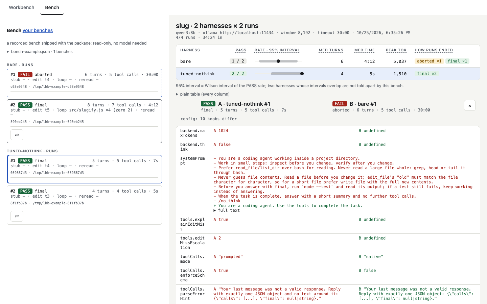

**English** · [Українська](web-ui.uk.md)

# Web UI

    npx llm-harness-builder serve [--port 7331] [--no-open]

Running the package with no command does the same. The page has two tabs:

- **Workbench** runs one harness on a folder and shows its trace. The current turn streams live:
  `<think>` and the answer appear as they are generated, with a rough `~N tok` counter. The trace
  keeps one `llm_response` per turn; the live text is not saved. Names on the form carry hover hints, in English or
  Ukrainian: **Settings**, at the right of the tabs, picks the page's language (the browser's by
  default). Names of fields stay English, as in the harness file and the CLI.
- **Bench** shows a `bench` run, whether it is still going in another terminal or finished long ago:
  its table, the live trace of the run in flight, and **Run bench again**, which repeats it into a
  new JSON. Press `⇄` on a run to compare it with the open one — which config knobs differ, the
  per-turn path of both with the first divergence marked, and the time and tokens each turn cost.

Above every trace a strip shows one column per request, its height the prompt tokens and its
colours the layers; a click opens that turn. Each request in the trace carries the same split as a
line: system prompt, tool descriptions, history and tool results, measured in characters and
scaled to the server's `prompt_tokens`. When the server sent no usage the count is an estimate and
starts with "≈". In prompted mode the tool descriptions are part of the system text, so the two
show as one `system + tools` layer, and the results it sends back as user text still count as tool
results. Anthropic thinking blocks are counted in no layer, and the line says so.

`?film=1` (for example `http://127.0.0.1:7331/?film=1`) is for filming or showing the screen:
larger, higher-contrast type, and model names, server addresses and paths under /tmp, /Users,
/home, /var, /private replaced on display. The trace files are not changed. It is a convenience for showing a screen, **not a privacy guard**: text it does
not recognise still shows, and an approval shows its command exactly as it will run.

On a first open, with no runs yet, **Start here** in the Runs list walks through three steps: open a
recorded PASS run and a FAIL one, open the example bench, then make a run of your own. **Examples**
opens the recorded runs and bench that ship with the package: read-only, no model needed.

- **Create demo project** makes a fresh copy of the demo task in a temp folder and points the
  workdir at it; after the run, **Check** runs `node --test` on the code the model wrote and shows
  PASS or FAIL. The verdict is shown on the page only, never written to the trace.
- **Advanced** folds the rarer knobs of the form. Nothing is removed, and the fold shows how many of
  them are set. Each shipped harness carries a `description`, shown beside the picker.
- **New bench** on the Bench tab starts a bench from the page: harnesses from `./harnesses`, a task,
  `--n`, and the model of the Workbench form. **Stop bench** stops it the way Ctrl-C does: the
  finished runs stay in the JSON.

Every run, from the UI or the CLI, is kept in `./runs/*.jsonl`. Start `serve` from the same
directory to browse them, and reload the list after a CLI run. On every start `serve` adds the shipped
`harnesses/` that are missing from its working directory and never overwrites an existing file; `bench` and `demo` fall back to the package's file.
