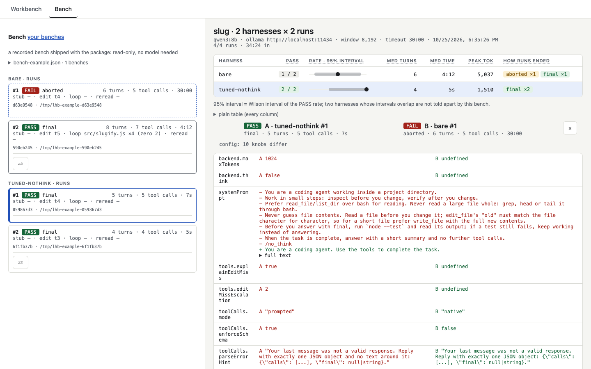

[English](web-ui.md) · **Українська**

# Веб-інтерфейс

    npx llm-harness-builder serve [--port 7331] [--no-open]

Запуск пакета без команди робить те саме. На сторінці дві вкладки:

- **Workbench** запускає один харнес на теці й показує його трейс. Поточний хід іде наживо:
  `<think>` і відповідь з'являються в міру генерації, з приблизним лічильником `~N tok`. У трейсі
  лишається одна `llm_response` на хід; живий текст не зберігається. Назви полів у формі мають
  підказки при наведенні, англійською або українською: мову сторінки вибирає кнопка **Налаштування**
  праворуч від вкладок (за замовчуванням — мова браузера). Назви полів лишаються англійськими, як у
  файлі харнесу і в CLI.
- **Bench** показує прогін `bench` — і той, що досі йде в іншому терміналі, і давно завершений: його
  таблицю, живий трейс поточного прогону і **Run bench again**, що повторює його в новий JSON.
  Натисніть `⇄` на прогоні, щоб порівняти його з відкритим: які ручки конфігу відрізняються, шлях
  обох хід за ходом з позначкою першого розходження, і скільки часу й токенів коштував кожен хід.

Над кожним трейсом смуга показує по стовпчику на запит: висота — токени промпту, кольори — шари;
клік відкриває цей хід. Кожен запит у трейсі має той самий розклад рядком: системний промпт, описи
інструментів, історія і результати інструментів, виміряні в символах і масштабовані до
`prompt_tokens` сервера. Коли сервер не надіслав usage, число — оцінка і починається з «≈». У
промптовому режимі описи інструментів входять у системний текст, тож обидва показано одним шаром
`system + tools`, а результати, які він повертає текстом користувача, все одно рахуються як
результати інструментів. Блоки thinking від Anthropic не входять у жоден шар, і рядок про це каже.

`?film=1` (наприклад, `http://127.0.0.1:7331/?film=1`) — для зйомки чи показу екрана: більший,
контрастніший шрифт, а назви моделей, адреси серверів і шляхи під /tmp, /Users, /home, /var,
/private на екрані замінено. Файли трейсів не змінюються. Це зручність для показу екрана, **а не захист приватності**: текст, якого
режим не розпізнає, видно як є, а запит на схвалення показує команду точно такою, якою вона
виконається.

Під час першого відкриття, поки прогонів ще немає, **Почніть звідси** у списку Runs веде через три
кроки: відкрити записаний прогін PASS і прогін FAIL, відкрити приклад бенча, потім зробити власний
прогін. **Examples** відкриває записані прогони й бенч, що постачаються з пакетом: лише для
читання, модель не потрібна.

- **Create demo project** робить свіжу копію демо-задачі в тимчасовій теці й ставить на неї
  workdir; після прогону **Check** запускає `node --test` на коді, який написала модель, і показує
  PASS або FAIL. Вердикт видно лише на сторінці, у трейс він не пишеться.
- **Advanced** згортає рідші ручки форми. Нічого не прибрано, а згорток показує, скільки з них
  задано. Кожен харнес із пакета має `description`, що видно поряд із вибором харнесу.
- **New bench** на вкладці Bench запускає бенч зі сторінки: харнеси з `./harnesses`, задача, `--n`
  і модель із форми Workbench. **Stop bench** зупиняє його так само, як Ctrl-C: завершені прогони
  лишаються в JSON.

Кожен прогін, з інтерфейсу чи з CLI, зберігається в `./runs/*.jsonl`. Запускайте `serve` з тієї ж
теки, щоб їх переглядати, і оновлюйте список після прогону з CLI. При кожному старті `serve` додає
харнеси з `harnesses/` пакета, яких бракує в його робочій теці, і ніколи не перезаписує наявні файли;
`bench` і `demo` беруть файл із пакета.
